# FIDUNIO input probe — android — fix

| Check | What | Expected | Observed | |
|---|---|---|---|---|
| STARTUP-ONCE | After sign-in, count how many times each start-up step started | every step exactly once, in order | order: notification upkeep → conversations → blocked users → groups → HELP → activation → publish E2EE key / counts: {"notification upkeep":1,"conversations":1,"blocked users":1,"groups":1,"HELP":1,"activation":1,"publish E2EE key":1} | as expected |
| COPY | Press and hold a message, tap Copy | sheet offers Copy; the phone clipboard then holds the message text | Copy button present; clipboard now: " Copy test 4417" | as expected |
| SELECT-TEXT | Press and hold a message, Select Text, press and hold one word, tap Copy, then Done | only that word is copied; Done goes back to the same chat | marked: "Copy"; copied: "Copy"; after Done: same chat | as expected |
| LINK | Send "Visit https://example.com today", tap the link: Cancel, then tap again: Open | "Open this link?" first; Cancel stays in the chat; Open shows the web page outside FIDUNIO | asked first: true; Cancel stayed in chat: true; after Open: org.chromium.webview_shell/.WebViewBrowserActivity | as expected |
| PASTE | Press and hold the message box, tap the phone's Paste | the copied text appears in the message box | phone Copy (keyboard shortcut) used; phone Paste (keyboard shortcut) used; message box now: "Paste test 2286" | as expected |
| PICTURE-PASTE | A paste that carries a picture (what an iPhone sticker sends) | FIDUNIO sends it as a photo | a new message appeared (6:13 PM Sent) | as expected |
| KEYBOARD-GIF | A GIF handed over by the keyboard (fix branch: native hand-over event) | FIDUNIO sends it as a photo | GIF message appeared | as expected |
| KEYBOARD-GIF-OFFER | Does the message box tell the keyboard it accepts GIFs? | yes on the fix branch | GIF types offered to the keyboard | as expected |
| CAMERA | Photo → Take a Picture | the camera opens | in front: com.android.camera2/com.android.camera.CaptureActivity | as expected |
| GRACE | Switch to another app for ~15 s, then back | FIDUNIO opens unlocked (5 min grace) | unlocked | as expected |
| BACK-CHAT | Back swipe from the edge while in a chat | goes back to the Messages list, FIDUNIO stays in front | Messages list shown | as expected |
| BACK-POPUP | Back swipe with a pop-up open | the pop-up closes first | pop-up was open; after Back: closed, chat still shown | as expected |
| BACK-MAIN | Back swipe on the Messages list | FIDUNIO goes to the background (still running) | started on Messages list; in front: com.android.settings/.Settings; FIDUNIO still running | as expected |
| BACK-RETURN | Return right after the Back swipe | unlocked (within grace) | unlocked | as expected |
| BACK-KEY | 3-button Back key while in a chat | goes back to the Messages list | Messages list shown | as expected |
| HELP-SETTINGS | Settings → HELP: the contacts list is closed; tap "Choose HELP contacts", tick Simulator Bob, Save | list closed at first; "Saved."; the server has Bob as the only HELP contact | list closed at first: true; screen: "Saved.", "HELP contacts: Simulator Bob"; server: enabled=true, contacts=1 | as expected |
| HELP-SAVE-REPEAT | 5 times: untick Bob → Save, then tick Bob → Save; check the contacts line and the HELP bar each time | every Save shows the right contacts, and the HELP bar follows | all 10 saves right | as expected |
| HELP-BAR | Back to Messages | one red HELP bar on the Messages screen, no banners | HELP bar shown; banners: none | as expected |
| HELP-QUICK-TAP | HELP screen: a quick tap on the big button (not held) | nothing is sent (it needs a 2-second hold) | nothing sent | as expected |
| HELP-DARK | Dark mode on; open the HELP hold screen | the title, hint and back arrow are clearly readable (contrast 4.5 or more) | contrast of title / hint / back: [15.2,15.2,15.2] | as expected |
| HELP-SEND | Press and hold the HELP button for 3 seconds; allow location when the phone asks | red "HELP is sent — Simulator Bob is being called", the conversation on the same screen, "I'm OK now"; server has an open alert for Bob | screen: "HELP is sent Simulator Bob is being called. Stay where you are. You: HELP Open in Maps Send I'm OK now"; location prompts answered: ONLY THIS TIME; server: open alert for Bob | as expected |
| HELP-WRITE | On the same HELP screen: type "Help chat 7731" in the big box and tap Send | the message shows in the conversation on the HELP screen (no separate chat screen) | conversation on HELP screen: You: HELP Open in Maps You: Help chat 7731; reached the server: yes (11→12) | as expected |
| HELP-COMING-SEEN | Alice starts typing "draft 88" (not sent); Bob answers "I'm coming" (from his phone) | green "Simulator Bob is coming" on the same screen; the conversation and the unsent "draft 88" are still there | green: true; screen: "Simulator Bob is coming Stay where you are. You: HELP Open in Maps You: Help cha"; unsent text kept: "draft 88"; conversation still shown: true | as expected |
| HELP-OK | Tap "I'm OK now", then open the regular chat with Bob | the alert closes (server: safe); the regular chat has everything from the HELP screen: HELP, "Help chat 7731", "I'm OK now" | server: safe; bar: "HELP"; regular chat has HELP + message + OK: true (HELP contacts. 6:18 PM Sent You are now one of my HELP contacts. 6:19 PM Sent HELP Open in Maps 6:20 PM Sent Help chat 7731 6:20 PM Sent I'm OK now 6:20 PM Sent) | as expected |
| HELP-INCOMING | The chat with Bob is made as if BOB started it (member order Bob, Alice). Bob sends HELP to Alice; Alice taps "I'm coming", types "On my way 5512" and taps Send | red "Simulator Bob needs HELP" opens by itself; after "I'm coming" the conversation is on the same screen; the message is sent (no "Conversation could not be started"); the server has Alice's answer | chat made by Bob first: true; opened: "‹ Simulator Bob needs HELP Sent at 6:20 PM Location is on it"; server: Alice is coming; conversation: You: I'm OK now You: I'm coming You: On my way 5512; "could not be started": false | as expected |
| HELP-RESUME | Bob sends HELP while FIDUNIO is in the background; Alice opens FIDUNIO again — back from the background (no PIN) — and taps nothing | the red "Simulator Bob needs HELP" screen is there by itself | screen: helpAlert "‹ Simulator Bob needs HELP Sent at 6:21 PM Location is on it"; HELP trace ["18:18:50 settings card contacts=0 (Saved.)","18:18:50 settings snapshot exists=true cache=false pending=false contacts=0","18:19:04 settings card contacts=0","18:19:08 settings card contacts=0","18:19:17 settings snapshot exists=true cache=false pending=true contacts=1","18:19:17 settings applied (this phone's save) contacts=1","18:19:18 saved contacts=1","18:19:18 settings snapshot exists=true cache=false pending=false contacts=1","18:19:18 settings card contacts=1 (Saved.)","18:21:33 HELP contact of 1"] | as expected |
| HELP-RESUME-RESTART | Bob sends HELP while FIDUNIO is in the background; Alice opens FIDUNIO again — FIDUNIO restarted and unlocked with the PIN — and taps nothing | the red "Simulator Bob needs HELP" screen is there by itself | screen: helpAlert "‹ Simulator Bob needs HELP Sent at 6:21 PM Location is on it"; HELP trace ["18:22:14 start","18:22:14 stop","18:22:15 settings snapshot exists=true cache=false pending=false contacts=1","18:22:15 settings applied (server read) contacts=1","18:22:15 HELP contact of 1"] | as expected |
| HELP-REMINDER | Bob chose Alice as a HELP contact; notifications were never turned on on this phone. Switch away and back | a red reminder on Messages: "Notifications are off on this device. Simulator Bob chose you as a HELP contact…" with "Turn on notifications" | reminder: "NOT SHOWN"; trace ["18:22:14 start","18:22:14 stop","18:22:15 settings snapshot exists=true cache=false pending=false contacts=1","18:22:15 settings applied (server read) contacts=1","18:22:15 HELP contact of 1","18:22:34 HELP contact of 1"] | **DIFFERENT** |
| HELP-TURN-ON | Tap "Turn on notifications" and allow notifications when the phone asks | the phone asks once; after Allow the reminder goes away (or, if the test server cannot register this simulator, a clear message says why) | no reminder button | **DIFFERENT** |
| HELP-TAP-ALARM | Bob sends HELP; Alice sees it and goes back to Messages; FIDUNIO goes to the background; the HELP alarm notification arrives and Alice taps it | FIDUNIO opens on the big red "Simulator Bob needs HELP" screen (not the regular chat) | Android: launch with the notification data; screen: helpAlert "‹ Simulator Bob needs HELP Sent at 6:23 PM Location is on it" | as expected |
| HELP-TAP-CHAT | Same HELP still on: back to Messages, background; the CHAT notification of a message in the HELP conversation arrives and Alice taps it | the big red HELP screen opens (not the regular chat) | Android: launch with the notification data; screen: helpAlert "‹ Simulator Bob needs HELP Sent at 6:23 PM Location is on it" | as expected |
| HELP-TAP-CHAT-AFTER | Bob taps "I'm OK now" (HELP over); Alice taps a chat notification from Bob | the regular chat with Bob opens, as usual | Android: launch with the notification data; screen: chat | as expected |
| HELP-REACH | Alice's Settings → HELP with Bob chosen; Bob's notifications not confirmed, then Bob turns them on (from his phone) | first: "Simulator Bob may not hear your HELP…"; after Bob turns them on and Settings is opened again: no warning | before: "Simulator Bob may not hear your HELP: notifications are off or not confirmed. Ask them to "; after: "no warning" | as expected |
| HELP-SIGNOUT | Settings: Sign Out button | no PIN asked for Sign Out (protection removed); not tapped | Sign Out shown: true; Protect/Test removed: true | as expected |
| PIN-MISSING-ASKS | Delete only the lock PIN record, restart FIDUNIO | password + PIN screen ("PIN record is missing"); no PIN-only screen; FIDUNIO not open | record before: true; deleted: true; password box: true; FIDUNIO open: false; screen: "FIDUNIO Private Messaging This device's PIN record is missing. Enter your password and PIN to unlock. Password Show pass" | as expected |
| PIN-MISSING-WRONG | Type the password and a WRONG PIN | stays locked, "Nothing was changed" | FIDUNIO open: false; PIN record written: false; message: "Could not unlock with this password and PIN. Nothing was changed." | as expected |
| PIN-MISSING-RIGHT | Type the password and the right PIN | FIDUNIO opens; the same PIN is saved back; after a restart the normal PIN screen unlocks with it | opened: true; PIN record saved back: true; next start PIN-only: true; same PIN unlocks: true | as expected |

### COPY — 02-copy-sheet.png

### SELECT-TEXT — 03-select-text-marked.png

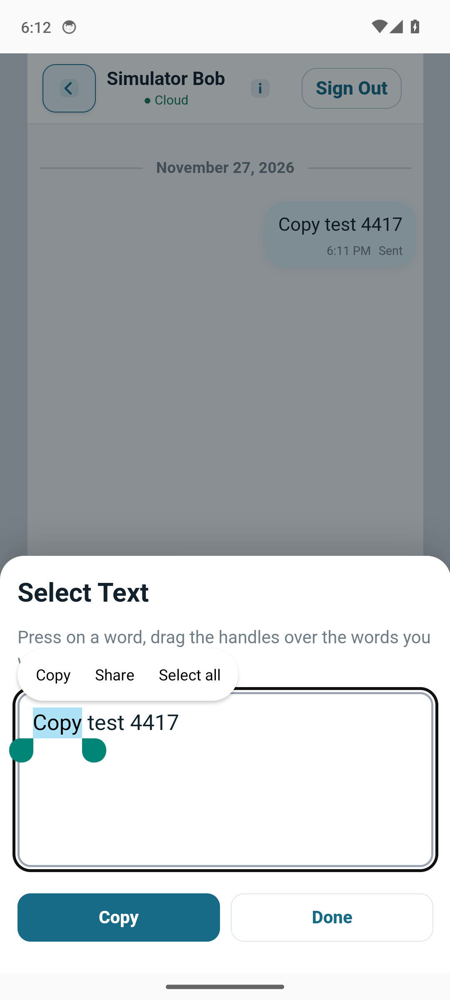

### SELECT-TEXT — 04-select-text-done.png

### LINK — 05-link-ask.png

### LINK — 06-link-opened.png

### PASTE — 08-after-paste.png

### PICTURE-PASTE — 09-picture-paste.png

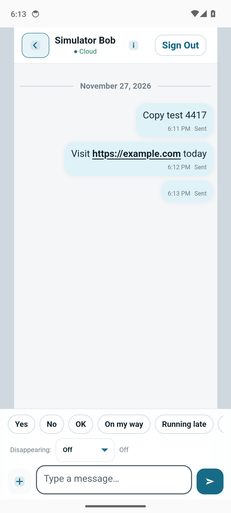

### KEYBOARD-GIF — 10-keyboard-gif.png

### CAMERA — 11-after-take-picture.png

### GRACE — 12-back-after-15s.png

### BACK-CHAT — 13-back-from-chat.png

### BACK-POPUP — 14-back-popup.png

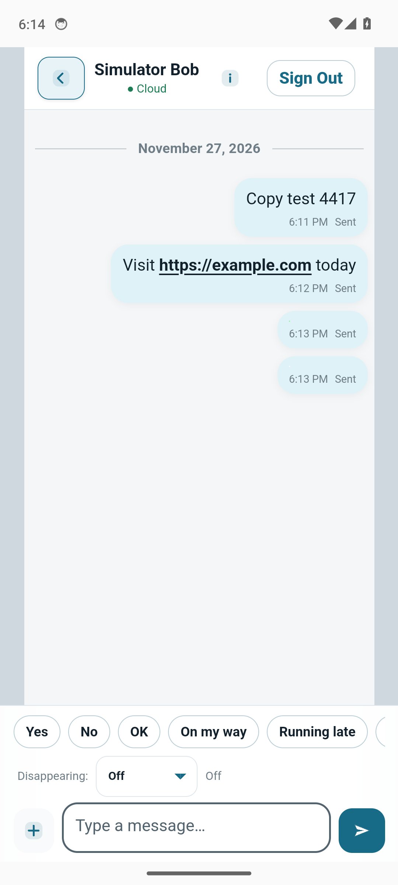

### BACK-MAIN — 15-back-main.png

### BACK-RETURN — 16-return-after-back.png

### BACK-KEY — 17-back-key.png

### HELP-SETTINGS — 18-help-settings-closed.png

### HELP-SETTINGS — 19-help-settings-saved.png

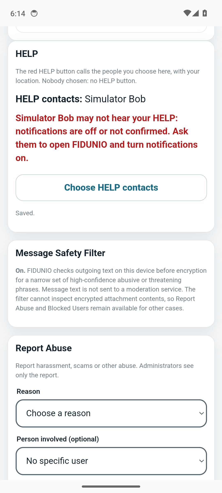

### HELP-SAVE-REPEAT — 20-help-save-repeat.png

### HELP-BAR — 21-help-bar.png

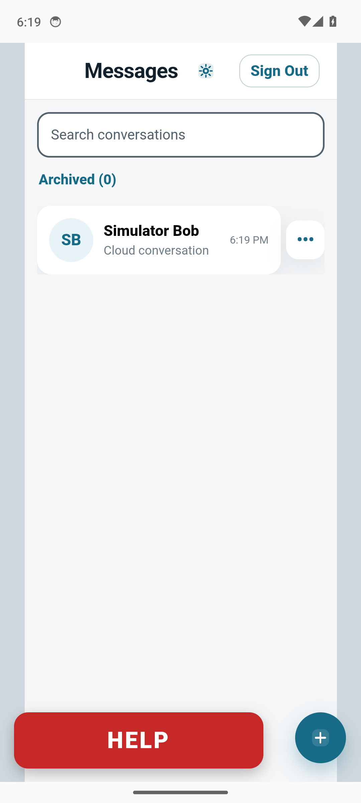

### HELP-QUICK-TAP — 22-help-quick-tap.png

### HELP-DARK — 23-help-dark.png

### HELP-SEND — 24-help-sent.png

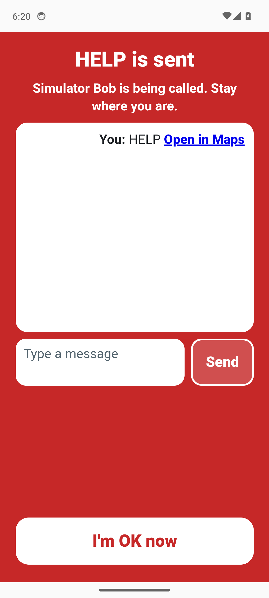

### HELP-WRITE — 25-help-chat-on-screen.png

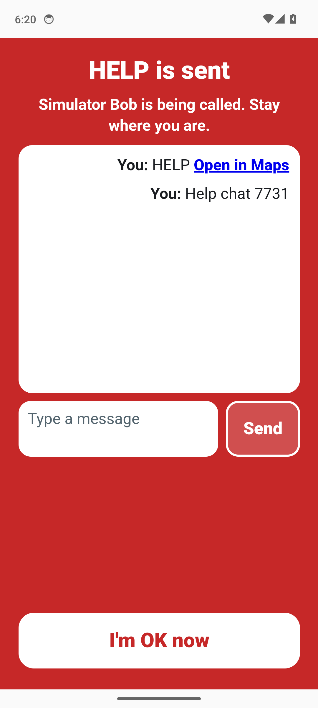

### HELP-COMING-SEEN — 26-help-coming.png

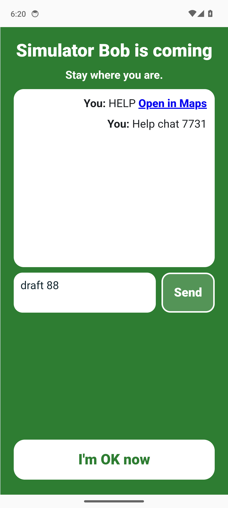

### HELP-OK — 27-help-ok-regular-chat.png

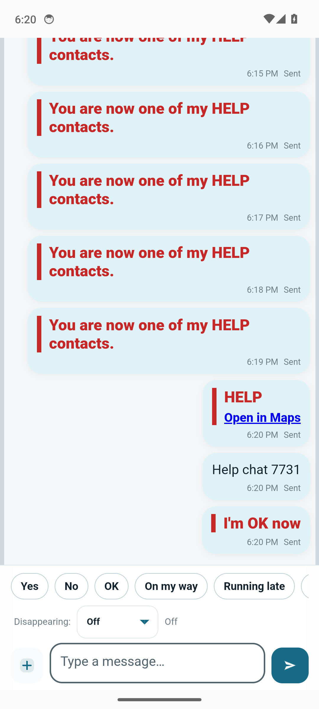

### HELP-INCOMING — 28-help-incoming.png

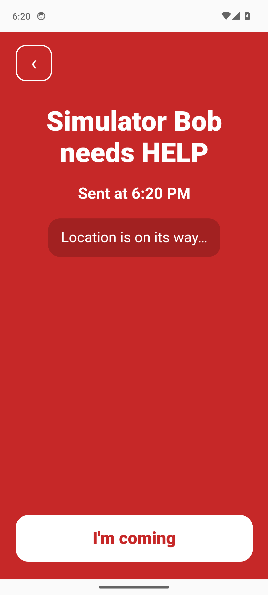

### HELP-INCOMING — 29-help-im-coming-chat.png

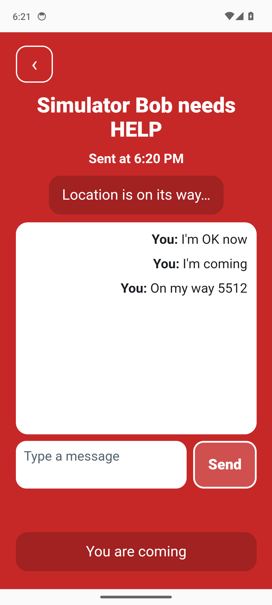

### HELP-RESUME — 30-help-resume.png

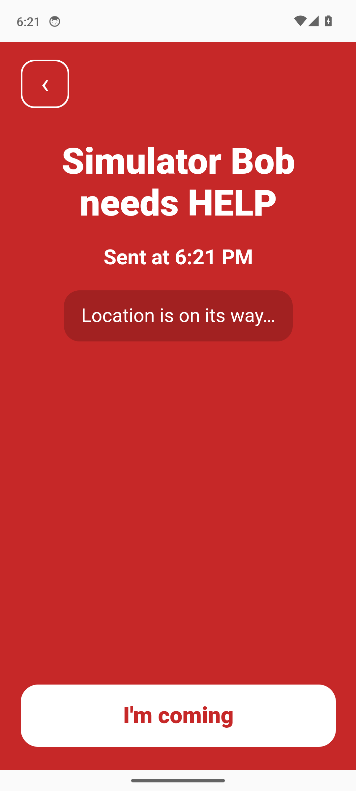

### HELP-RESUME-RESTART — 31-help-resume-restart.png

### HELP-REMINDER — 32-help-reminder.png

### HELP-TAP-ALARM — 33-help-tap-alarm.png

### HELP-TAP-CHAT — 34-help-tap-chat.png

### HELP-TAP-CHAT-AFTER — 35-help-tap-chat-after.png

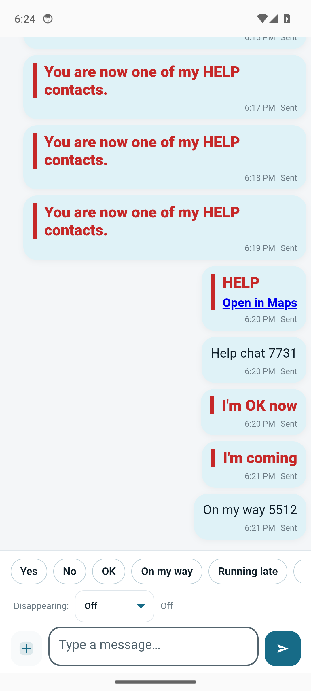

### HELP-REACH — 36-help-reach-warning.png

### HELP-REACH — 37-help-reach-ok.png

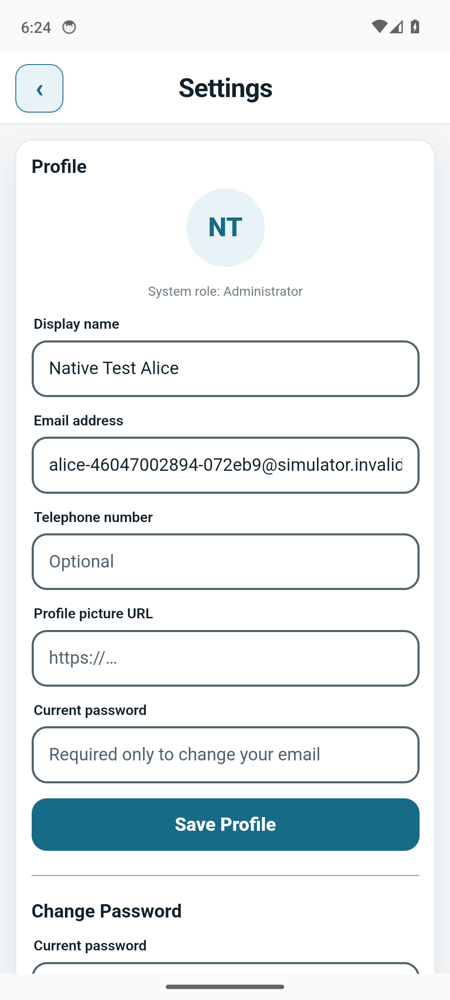

### HELP-SIGNOUT — 38-help-settings-kiss.png

### PIN-MISSING-ASKS — 39-pin-missing.png

### PIN-MISSING-WRONG — 40-pin-wrong.png

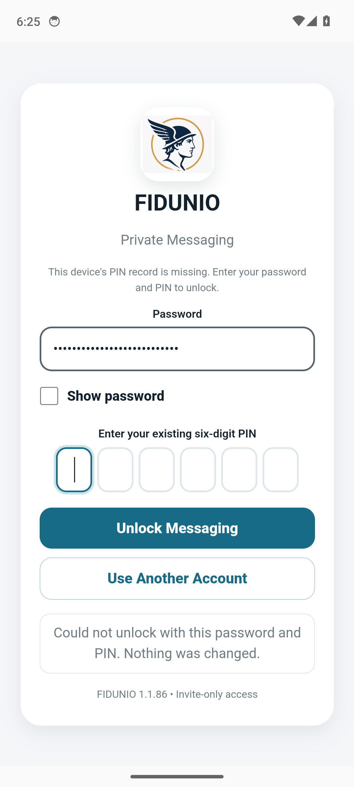

### PIN-MISSING-RIGHT — 41-pin-restored.png

### PIN-MISSING-RIGHT — 42-pin-normal-again.png

