# FIDUNIO input probe — android — fix

| Check | What | Expected | Observed | |
|---|---|---|---|---|
| STARTUP-ONCE | After sign-in, count how many times each start-up step started | every step exactly once, in order | order: notification upkeep → conversations → blocked users → groups → HELP → activation → publish E2EE key / counts: {"notification upkeep":1,"conversations":1,"blocked users":1,"groups":1,"HELP":1,"activation":1,"publish E2EE key":1} | as expected |
| COPY | Press and hold a message, tap Copy | sheet offers Copy; the phone clipboard then holds the message text | Copy button present; clipboard now: " Copy test 4417" | as expected |
| SELECT-TEXT | Press and hold a message, Select Text, press and hold one word, tap Copy, then Done | only that word is copied; Done goes back to the same chat | marked: "Copy"; copied: "Copy"; after Done: same chat | as expected |
| LINK | Send "Visit https://example.com today", tap the link: Cancel, then tap again: Open | "Open this link?" first; Cancel stays in the chat; Open shows the web page outside FIDUNIO | asked first: true; Cancel stayed in chat: true; after Open: org.chromium.webview_shell/.WebViewBrowserActivity | as expected |
| PASTE | Press and hold the message box, tap the phone's Paste | the copied text appears in the message box | phone Copy (keyboard shortcut) used; phone Paste (keyboard shortcut) used; message box now: "Paste test 2286" | as expected |
| PICTURE-PASTE | A paste that carries a picture (what an iPhone sticker sends) | FIDUNIO sends it as a photo | a new message appeared (7:54 AM Sent) | as expected |
| KEYBOARD-GIF | A GIF handed over by the keyboard (fix branch: native hand-over event) | FIDUNIO sends it as a photo | GIF message appeared | as expected |
| KEYBOARD-GIF-OFFER | Does the message box tell the keyboard it accepts GIFs? | yes on the fix branch | GIF types offered to the keyboard | as expected |
| CAMERA | Photo → Take a Picture | the camera opens | in front: com.android.camera2/com.android.camera.CaptureActivity | as expected |
| GRACE | Switch to another app for ~15 s, then back | FIDUNIO opens unlocked (5 min grace) | unlocked | as expected |
| BACK-CHAT | Back swipe from the edge while in a chat | goes back to the Messages list, FIDUNIO stays in front | Messages list shown | as expected |
| BACK-POPUP | Back swipe with a pop-up open | the pop-up closes first | pop-up was open; after Back: closed, chat still shown | as expected |
| BACK-MAIN | Back swipe on the Messages list | FIDUNIO goes to the background (still running) | started on Messages list; in front: com.android.settings/.Settings; FIDUNIO still running | as expected |
| BACK-RETURN | Return right after the Back swipe | unlocked (within grace) | unlocked | as expected |
| BACK-KEY | 3-button Back key while in a chat | goes back to the Messages list | Messages list shown | as expected |
| HELP-SETTINGS | Settings → HELP: the contacts list is closed; tap "Choose HELP contacts", tick Simulator Bob, Save | list closed at first; "Saved."; the server has Bob as the only HELP contact | list closed at first: true; screen: "Saved.", "HELP contacts: Simulator Bob"; server: enabled=true, contacts=1 | as expected |
| HELP-BAR | Back to Messages | one red HELP bar on the Messages screen, no banners | HELP bar shown; banners: none | as expected |
| HELP-QUICK-TAP | HELP screen: a quick tap on the big button (not held) | nothing is sent (it needs a 2-second hold) | nothing sent | as expected |
| HELP-SEND | Press and hold the HELP button for 3 seconds; allow location when the phone asks | red "HELP is sent — Simulator Bob is being called", "Write a message", "I'm OK now"; server has an open alert for Bob | screen: "HELP is sent Simulator Bob is being called Waiting for an answer… Stay where you are. Write a message I'm OK now"; location prompts answered: ONLY THIS TIME; server: open alert for Bob | as expected |
| HELP-WRITE | Tap "Write a message", type and send "Where are you?" | the HELP chat with Bob opens, with the HELP card and the map link; the message is sent | chat: ""; map link shown; text:  Sent 7:54 AM Sent 7:54 AM Sent You are now one of my HELP contacts. 7:56 AM Sent HELP Open in Maps 7:56 AM Sent Help chat 7731 7:56 AM Sent | as expected |
| HELP-COMING-SEEN | Bob answers "I'm coming" (from his phone); Alice opens the HELP bar | green "Simulator Bob is coming", "Write a message", "I'm OK now" | bar said: "HELP is on — open"; screen: "Simulator Bob is coming Stay where you are. Write a message I'm OK now"; green: true | as expected |
| HELP-OK | Tap "I'm OK now" | the alert closes (server: safe); back on Messages with the plain HELP bar | server: safe; bar: "HELP" | as expected |
| HELP-INCOMING | Bob sends HELP to Alice (from his phone) | Alice's FIDUNIO opens the red "Simulator Bob needs HELP" by itself; "I'm coming" tells the server and opens the chat with Bob | opened: "‹ Simulator Bob needs HELP Sent at 7:57 AM Location is on its way… I'm coming"; server: Alice is coming; chat opened: true | as expected |
| HELP-SIGNOUT | Settings: Sign Out button | no PIN asked for Sign Out (protection removed); not tapped | Sign Out shown: true; Protect/Test removed: true | as expected |
| PIN-MISSING-ASKS | Delete only the lock PIN record, restart FIDUNIO | password + PIN screen ("PIN record is missing"); no PIN-only screen; FIDUNIO not open | record before: true; deleted: true; password box: true; FIDUNIO open: false; screen: "FIDUNIO Private Messaging This device's PIN record is missing. Enter your password and PIN to unlock. Password Show pass" | as expected |
| PIN-MISSING-WRONG | Type the password and a WRONG PIN | stays locked, "Nothing was changed" | FIDUNIO open: false; PIN record written: false; message: "Could not unlock with this password and PIN. Nothing was changed." | as expected |
| PIN-MISSING-RIGHT | Type the password and the right PIN | FIDUNIO opens; the same PIN is saved back; after a restart the normal PIN screen unlocks with it | opened: true; PIN record saved back: true; next start PIN-only: true; same PIN unlocks: true | as expected |

### COPY — 02-copy-sheet.png

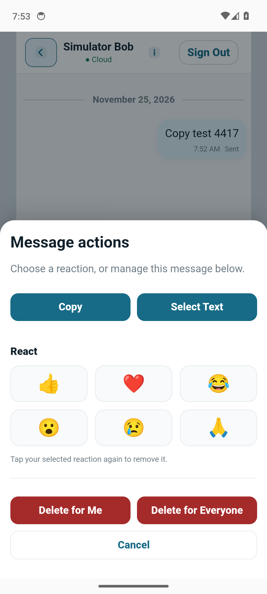

### SELECT-TEXT — 03-select-text-marked.png

### SELECT-TEXT — 04-select-text-done.png

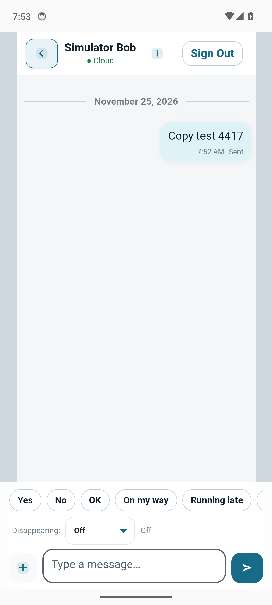

### LINK — 05-link-ask.png

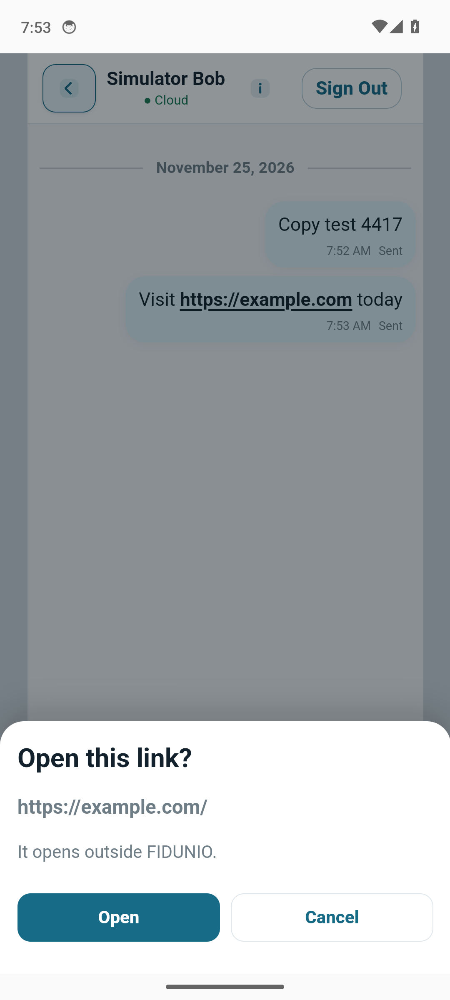

### LINK — 06-link-opened.png

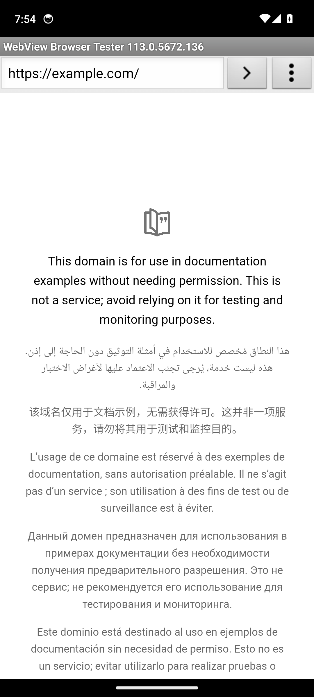

### PASTE — 08-after-paste.png

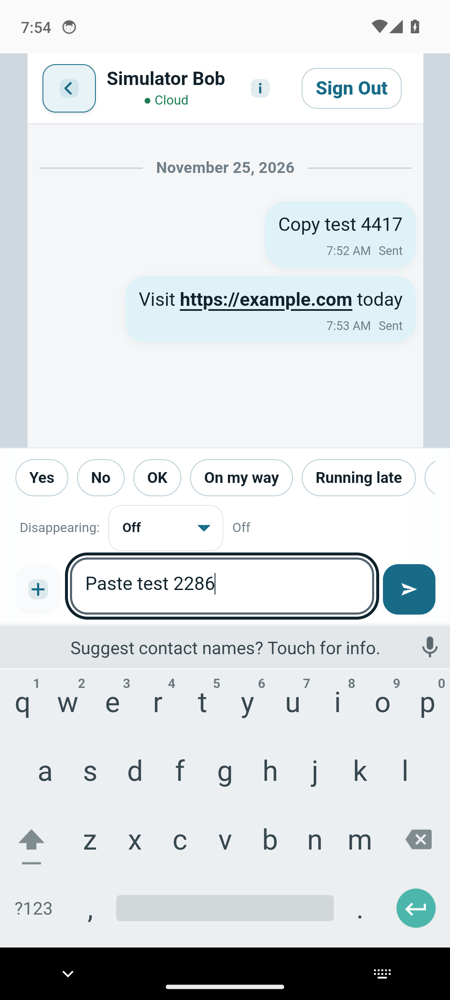

### PICTURE-PASTE — 09-picture-paste.png

### KEYBOARD-GIF — 10-keyboard-gif.png

### CAMERA — 11-after-take-picture.png

### GRACE — 12-back-after-15s.png

### BACK-CHAT — 13-back-from-chat.png

### BACK-POPUP — 14-back-popup.png

### BACK-MAIN — 15-back-main.png

### BACK-RETURN — 16-return-after-back.png

### BACK-KEY — 17-back-key.png

### HELP-SETTINGS — 18-help-settings-closed.png

### HELP-SETTINGS — 19-help-settings-saved.png

### HELP-BAR — 20-help-bar.png

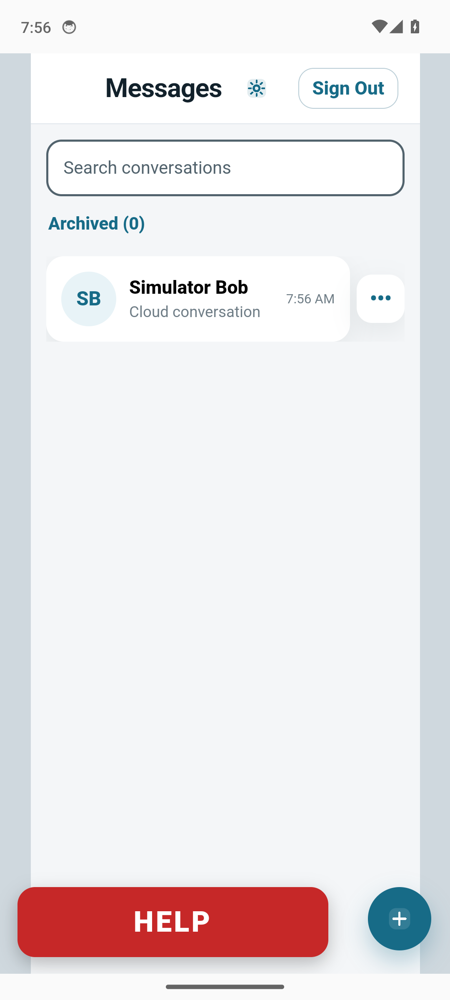

### HELP-QUICK-TAP — 21-help-quick-tap.png

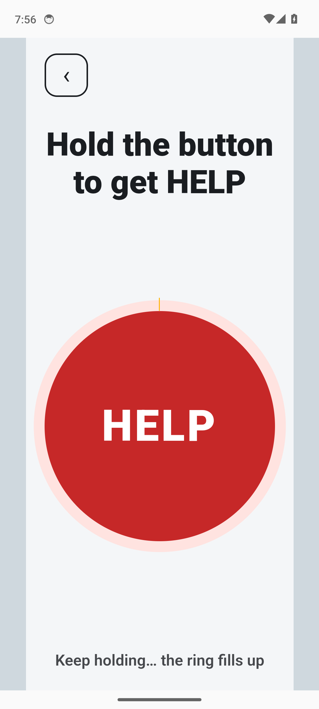

### HELP-SEND — 22-help-sent.png

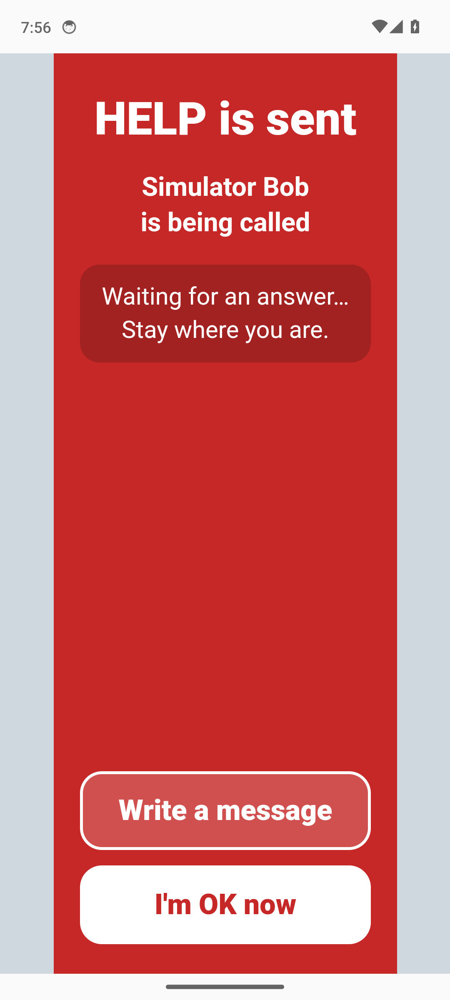

### HELP-WRITE — 23-help-chat.png

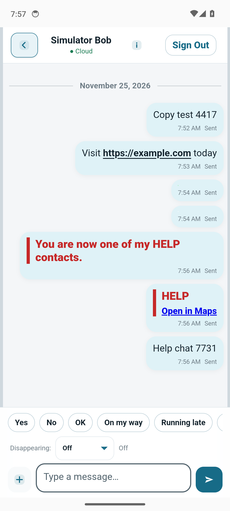

### HELP-COMING-SEEN — 24-help-coming.png

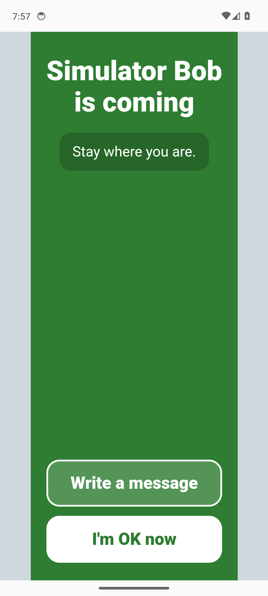

### HELP-OK — 25-help-ok.png

### HELP-INCOMING — 26-help-incoming.png

### HELP-INCOMING — 27-help-im-coming.png

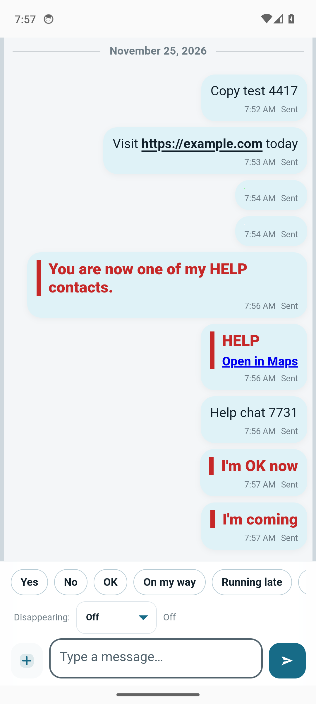

### HELP-SIGNOUT — 28-help-settings-kiss.png

### PIN-MISSING-ASKS — 29-pin-missing.png

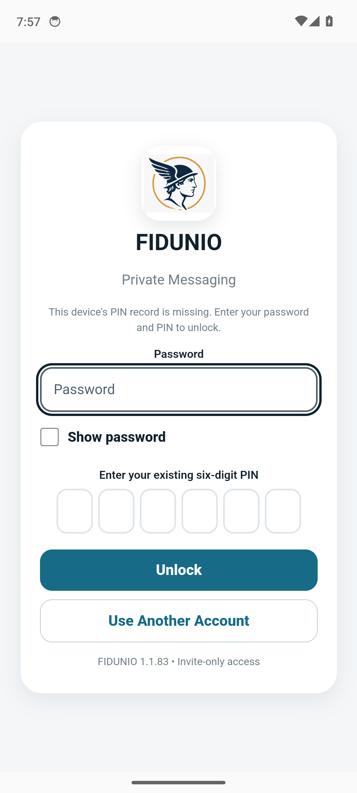

### PIN-MISSING-WRONG — 30-pin-wrong.png

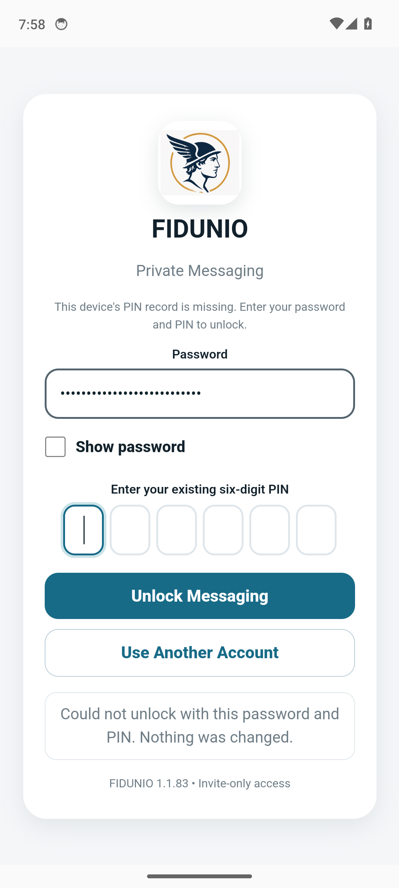

### PIN-MISSING-RIGHT — 31-pin-restored.png

### PIN-MISSING-RIGHT — 32-pin-normal-again.png

