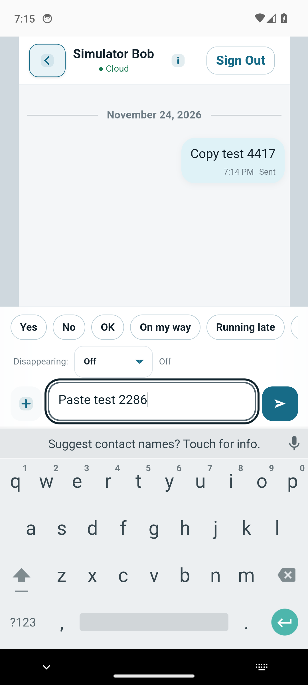
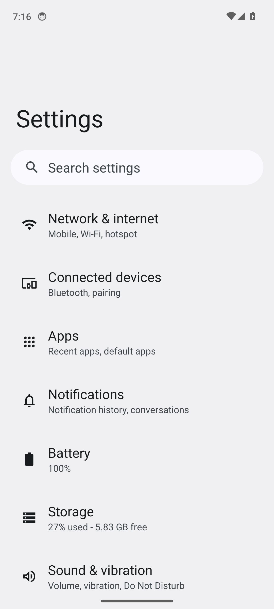

# FIDUNIO input probe — android — fix

| Check | What | Expected | Observed | |
|---|---|---|---|---|
| COPY | Press and hold a message, tap Copy | sheet offers Copy; the phone clipboard then holds the message text | Copy button present; clipboard now: " Copy test 4417" | as expected |
| PASTE | Press and hold the message box, tap the phone's Paste | the copied text appears in the message box | phone Copy (keyboard shortcut) used; phone Paste (keyboard shortcut) used; message box now: "Paste test 2286" | as expected |
| PICTURE-PASTE | A paste that carries a picture (what an iPhone sticker sends) | FIDUNIO sends it as a photo | a new message appeared (7:15 PM Sent) | as expected |
| KEYBOARD-GIF | A GIF handed over by the keyboard (fix branch: native hand-over event) | FIDUNIO sends it as a photo | GIF message appeared | as expected |
| KEYBOARD-GIF-OFFER | Does the message box tell the keyboard it accepts GIFs? | yes on the fix branch | GIF types offered to the keyboard | as expected |
| CAMERA | Photo → Take a Picture | the camera opens | in front: com.android.camera2/com.android.camera.CaptureActivity | as expected |
| GRACE | Switch to another app for ~15 s, then back | FIDUNIO opens unlocked (5 min grace) | unlocked | as expected |
| BACK-CHAT | Back swipe from the edge while in a chat | goes back to the Messages list, FIDUNIO stays in front | Messages list shown | as expected |
| BACK-POPUP | Back swipe with a pop-up open | the pop-up closes first | pop-up was open; after Back: closed, chat still shown | as expected |
| BACK-MAIN | Back swipe on the Messages list | FIDUNIO goes to the background (still running) | started on Messages list; in front: com.android.settings/.Settings; FIDUNIO still running | as expected |
| BACK-RETURN | Return right after the Back swipe | unlocked (within grace) | unlocked | as expected |
| BACK-KEY | 3-button Back key while in a chat | goes back to the Messages list | Messages list shown | as expected |

### COPY — 02-copy-sheet.png

### PASTE — 04-after-paste.png

### PICTURE-PASTE — 05-picture-paste.png

### KEYBOARD-GIF — 06-keyboard-gif.png

### CAMERA — 07-after-take-picture.png

### GRACE — 08-back-after-15s.png

### BACK-CHAT — 09-back-from-chat.png

### BACK-POPUP — 10-back-popup.png

### BACK-MAIN — 11-back-main.png

### BACK-RETURN — 12-return-after-back.png

### BACK-KEY — 13-back-key.png

