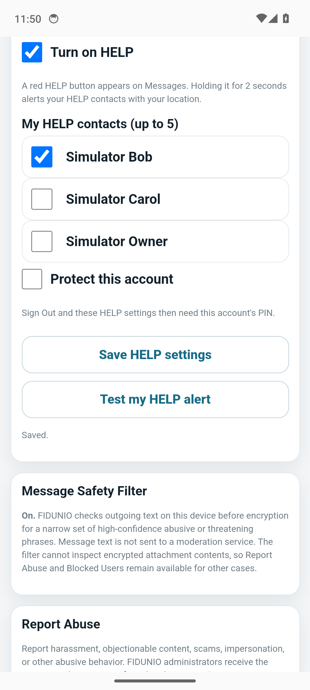
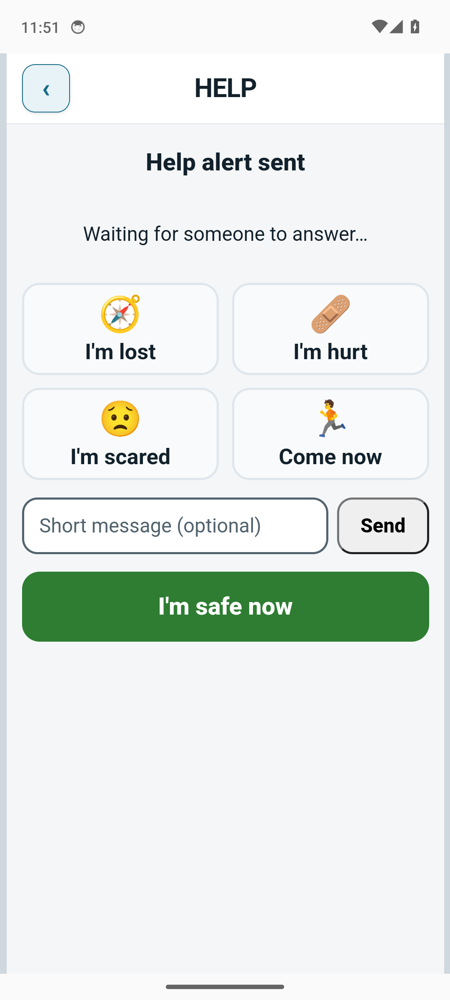
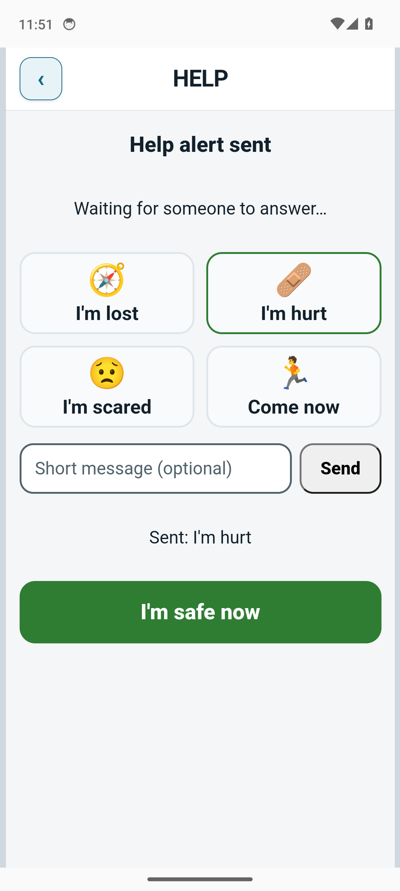
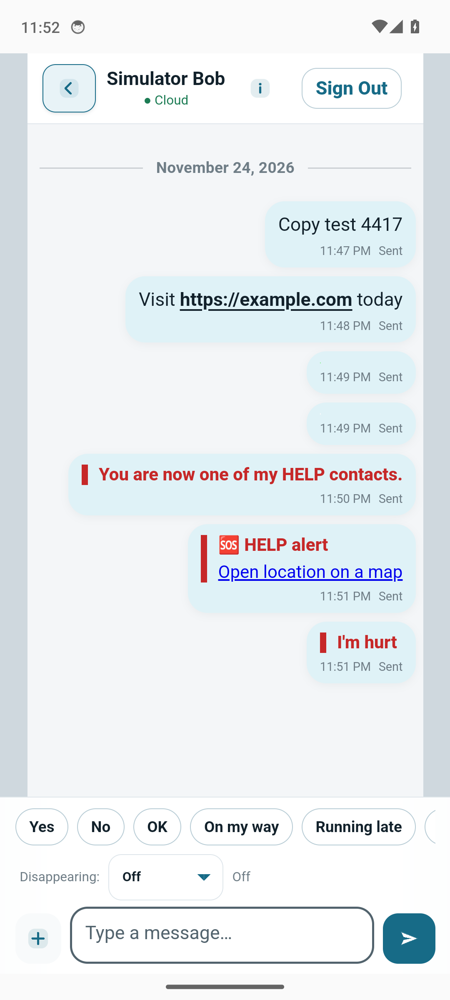
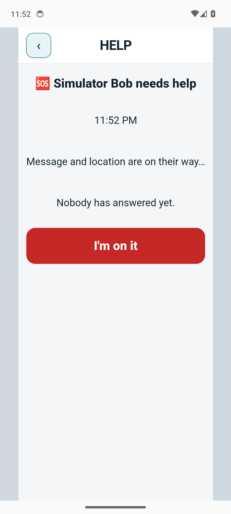
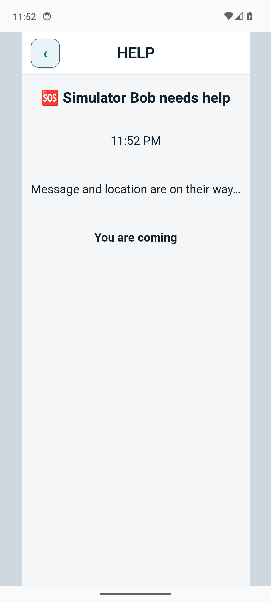
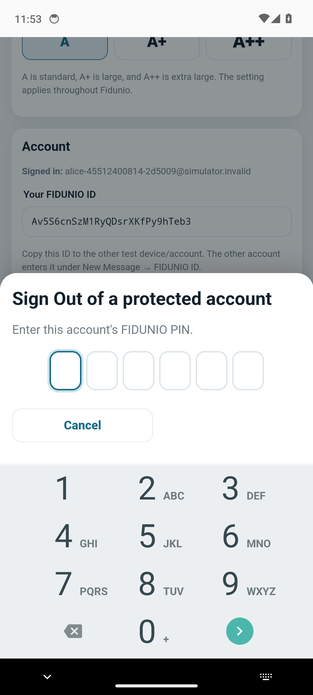

# FIDUNIO input probe — android — fix

| Check | What | Expected | Observed | |
|---|---|---|---|---|
| COPY | Press and hold a message, tap Copy | sheet offers Copy; the phone clipboard then holds the message text | Copy button present; clipboard now: " Copy test 4417" | as expected |
| SELECT-TEXT | Press and hold a message, Select Text, press and hold one word, tap Copy, then Done | only that word is copied; Done goes back to the same chat | marked: "Copy"; copied: "Copy"; after Done: same chat | as expected |
| LINK | Send "Visit https://example.com today", tap the link: Cancel, then tap again: Open | "Open this link?" first; Cancel stays in the chat; Open shows the web page outside FIDUNIO | asked first: true; Cancel stayed in chat: true; after Open: org.chromium.webview_shell/.WebViewBrowserActivity | as expected |
| PASTE | Press and hold the message box, tap the phone's Paste | the copied text appears in the message box | phone Copy (keyboard shortcut) used; phone Paste (keyboard shortcut) used; message box now: "Paste test 2286" | as expected |
| PICTURE-PASTE | A paste that carries a picture (what an iPhone sticker sends) | FIDUNIO sends it as a photo | a new message appeared (11:49 PM Sent) | as expected |
| KEYBOARD-GIF | A GIF handed over by the keyboard (fix branch: native hand-over event) | FIDUNIO sends it as a photo | GIF message appeared | as expected |
| KEYBOARD-GIF-OFFER | Does the message box tell the keyboard it accepts GIFs? | yes on the fix branch | GIF types offered to the keyboard | as expected |
| CAMERA | Photo → Take a Picture | the camera opens | in front: com.android.camera2/com.android.camera.CaptureActivity | as expected |
| GRACE | Switch to another app for ~15 s, then back | FIDUNIO opens unlocked (5 min grace) | unlocked | as expected |
| BACK-CHAT | Back swipe from the edge while in a chat | goes back to the Messages list, FIDUNIO stays in front | Messages list shown | as expected |
| BACK-POPUP | Back swipe with a pop-up open | the pop-up closes first | pop-up was open; after Back: closed, chat still shown | as expected |
| BACK-MAIN | Back swipe on the Messages list | FIDUNIO goes to the background (still running) | started on Messages list; in front: com.android.settings/.Settings; FIDUNIO still running | as expected |
| BACK-RETURN | Return right after the Back swipe | unlocked (within grace) | unlocked | as expected |
| BACK-KEY | 3-button Back key while in a chat | goes back to the Messages list | Messages list shown | as expected |
| HELP-SETTINGS | Settings → HELP Alert: Turn on, tick Simulator Bob, Save | "Saved."; the server has HELP on with Bob as the only contact | screen: "Saved."; server: enabled=true, contacts=1 | as expected |
| HELP-BUTTON | Back to Messages | a red HELP button is on the Messages screen | HELP button shown | as expected |
| HELP-QUICK-TAP | HELP screen: a quick tap on the big button (not held) | nothing is sent (it needs a 2-second hold) | nothing sent | as expected |
| HELP-SEND | Press and hold the HELP button for 3 seconds; allow location when the phone asks | "Help alert sent", a Cancel button, and the server has an open alert for Bob | screen: "Help alert sent"; location prompts answered: ONLY THIS TIME; server: open alert for Bob | as expected |
| HELP-PICTURE | Tap the "I'm hurt" picture button | the button marks as sent | "I'm hurt" sent | as expected |
| HELP-ACK | Bob answers "I'm on it" (from his phone) | Alice's HELP screen shows "Simulator Bob is coming" | screen: "Simulator Bob is coming" | as expected |
| HELP-CHAT-CARDS | Open the chat with Bob | HELP cards in the chat: the alert with "Open location on a map", and "I'm hurt" | map link shown; chat text: PM Sent 11:49 PM Sent 11:49 PM Sent You are now one of my HELP contacts. 11:50 PM Sent 🆘 HELP alert Open location on a map 11:51 PM Sent I'm hurt 11:51 PM Sent | as expected |
| HELP-SAFE | Open the HELP alert from the banner, tap "I'm safe now" | the alert closes (server: safe); HELP screen is back to the big button | server: safe; screen: big HELP button | as expected |
| HELP-INCOMING | Bob sends HELP to Alice (from his phone) | Alice's FIDUNIO opens "Simulator Bob needs help" by itself; "I'm on it" tells the server | opened: "🆘 Simulator Bob needs help"; server: Alice is on it | as expected |
| HELP-TEST | Settings → "Test my HELP alert", then "Cancel — it was a mistake" | TEST alert sent, then cancelled (server: cancelled) | screen: "TEST — Help alert sent"; server: cancelled | as expected |
| HELP-PROTECT | Settings: tick "Protect this account", Save (asks PIN), then try Sign Out | PIN asked to protect; Sign Out then asks the PIN, and Cancel keeps Alice signed in | PIN asked to protect: true; server protected=true; Sign Out asked PIN: true; after Cancel still signed in: true | as expected |

### COPY — 02-copy-sheet.png

### SELECT-TEXT — 03-select-text-marked.png

### SELECT-TEXT — 04-select-text-done.png

### LINK — 05-link-ask.png

### LINK — 06-link-opened.png

### PASTE — 08-after-paste.png

### PICTURE-PASTE — 09-picture-paste.png

### KEYBOARD-GIF — 10-keyboard-gif.png

### CAMERA — 11-after-take-picture.png

### GRACE — 12-back-after-15s.png

### BACK-CHAT — 13-back-from-chat.png

### BACK-POPUP — 14-back-popup.png

### BACK-MAIN — 15-back-main.png

### BACK-RETURN — 16-return-after-back.png

### BACK-KEY — 17-back-key.png

### HELP-SETTINGS — 18-help-settings-saved.png

### HELP-BUTTON — 19-help-fab.png

### HELP-QUICK-TAP — 20-help-quick-tap.png

### HELP-SEND — 21-help-sent.png

### HELP-PICTURE — 22-help-picture.png

### HELP-ACK — 23-help-ack.png

### HELP-CHAT-CARDS — 24-help-chat-cards.png

### HELP-SAFE — 25-help-safe.png

### HELP-INCOMING — 26-help-incoming.png

### HELP-INCOMING — 27-help-onit.png

### HELP-TEST — 28-help-test.png

### HELP-TEST — 29-help-test-cancelled.png

### HELP-PROTECT — 30-help-protect-signout.png

