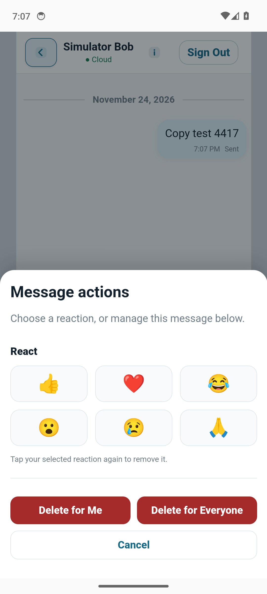
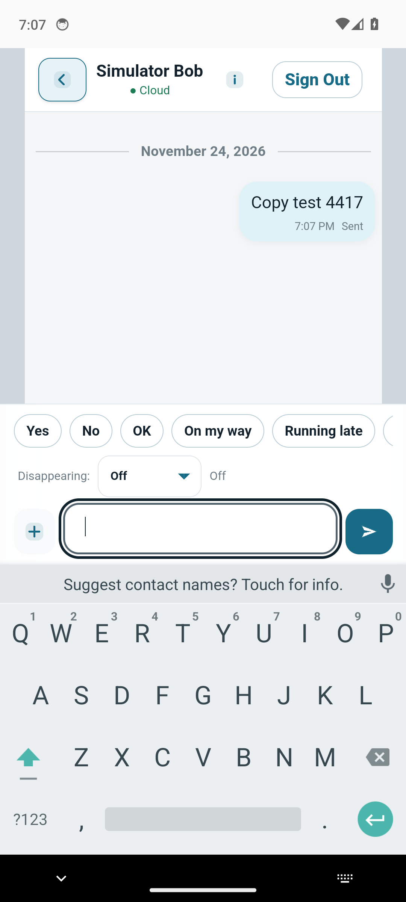
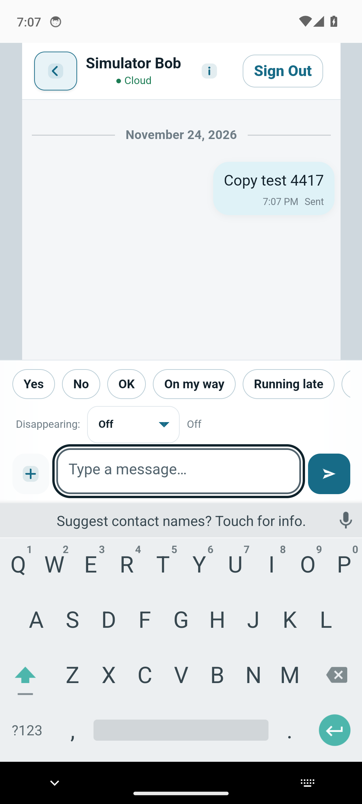
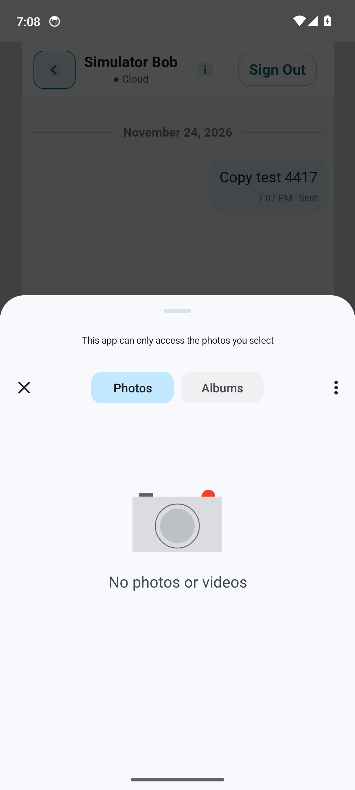
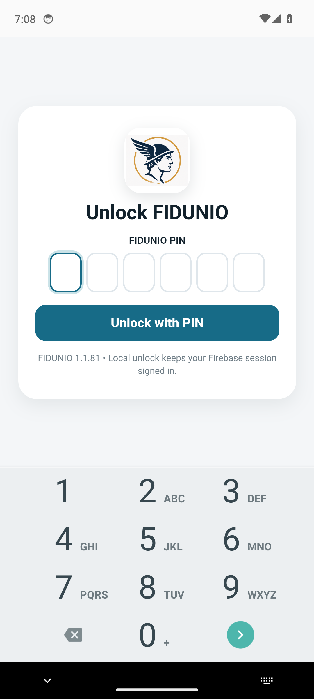
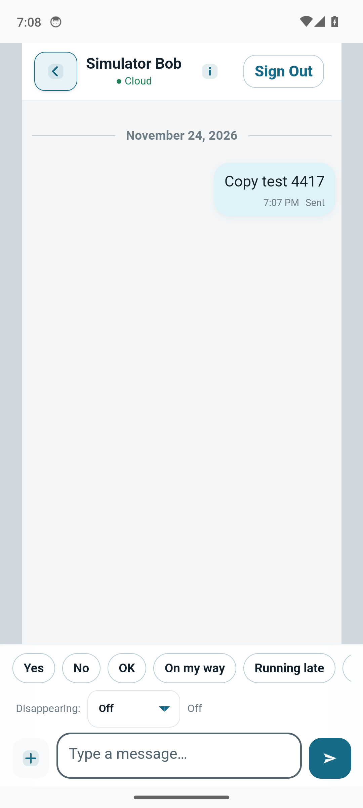
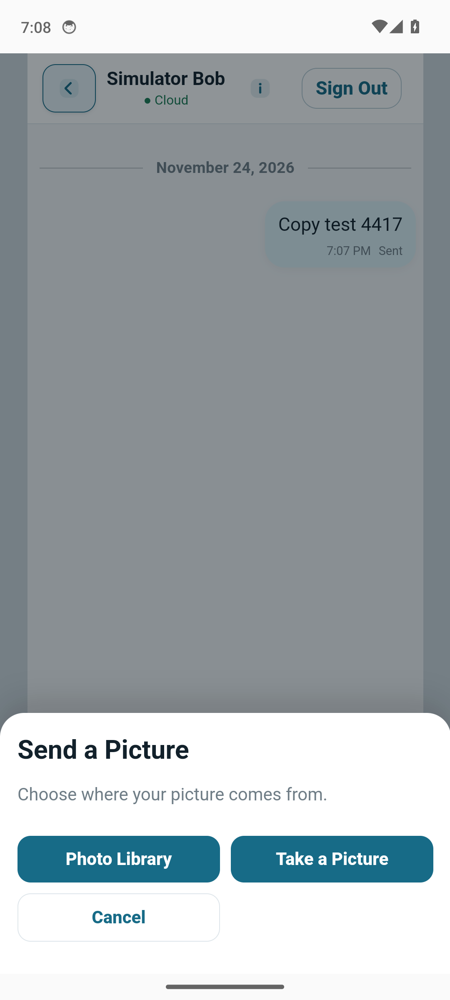
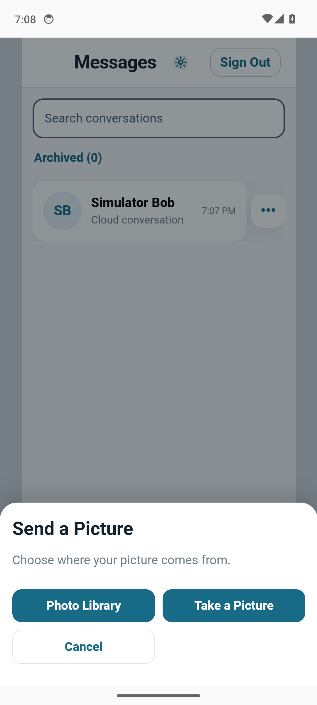

# FIDUNIO input probe — android — released

| Check | What | Expected | Observed | |
|---|---|---|---|---|
| COPY | Press and hold a message, tap Copy | sheet offers Copy; the phone clipboard then holds the message text | action sheet open; NO Copy button | **DIFFERENT** |
| PASTE | Press and hold the message box, tap the phone's Paste | the copied text appears in the message box | phone Copy NOT offered; NO Paste offered; message box now: "  " | **DIFFERENT** |
| PICTURE-PASTE | A paste that carries a picture (what an iPhone sticker sends) | FIDUNIO sends it as a photo | nothing was sent | **DIFFERENT** |
| KEYBOARD-GIF | A GIF handed over by the keyboard (fix branch: native hand-over event) | FIDUNIO sends it as a photo | nothing was sent | **DIFFERENT** |
| KEYBOARD-GIF-OFFER | Does the message box tell the keyboard it accepts GIFs? | yes on the fix branch | no GIF types visible in the keyboard connection | **DIFFERENT** |
| CAMERA | Photo → Take a Picture | the camera opens | in front: com.android.providers.media.module/com.android.providers.media.photopicker.PhotoPickerGetContentActivity | **DIFFERENT** |
| GRACE | Switch to another app for ~15 s, then back | FIDUNIO opens unlocked (5 min grace) | LOCKED — PIN asked | **DIFFERENT** |
| BACK-CHAT | Back swipe from the edge while in a chat | goes back to the Messages list, FIDUNIO stays in front | still on: Simulator Bob ● Cloud Sign Out November 24, 2026 Copy test 4417 7:07 PM Sent Yes | **DIFFERENT** |
| BACK-POPUP | Back swipe with a pop-up open | the pop-up closes first | pop-up was open; after Back: not closed | **DIFFERENT** |
| BACK-MAIN | Back swipe on the Messages list | FIDUNIO goes to the background (still running) | started on Messages list; in front: io.github.willyros01.fidunio/.MainActivity; FIDUNIO still running | **DIFFERENT** |
| BACK-RETURN | Return right after the Back swipe | unlocked (within grace) | unlocked | as expected |
| BACK-KEY | 3-button Back key while in a chat | goes back to the Messages list | in front: io.github.willyros01.fidunio/.MainActivity | **DIFFERENT** |

### COPY — 02-copy-sheet.png

### PASTE — 03-after-paste.png

### PICTURE-PASTE — 04-picture-paste.png

### KEYBOARD-GIF — 05-keyboard-gif.png

### CAMERA — 06-after-take-picture.png

### GRACE — 07-back-after-15s.png

### BACK-CHAT — 08-back-from-chat.png

### BACK-POPUP — 09-back-popup.png

### BACK-MAIN — 10-back-main.png

### BACK-RETURN — 11-return-after-back.png

### BACK-KEY — 12-back-key.png

