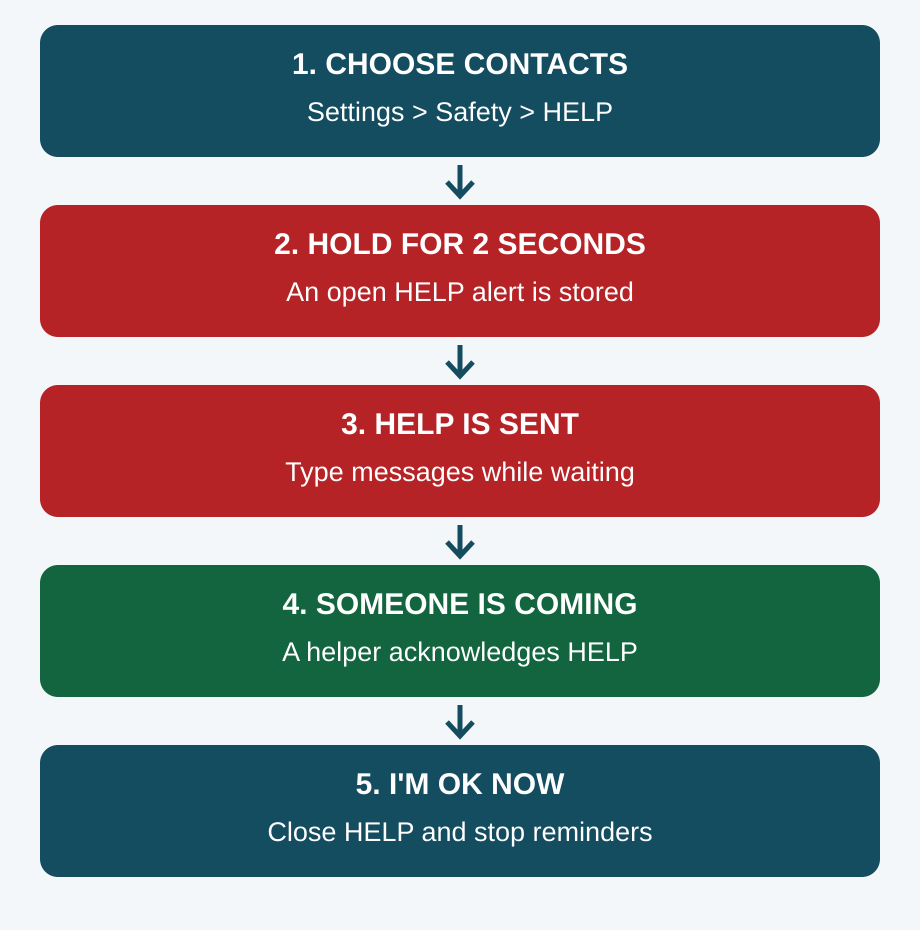
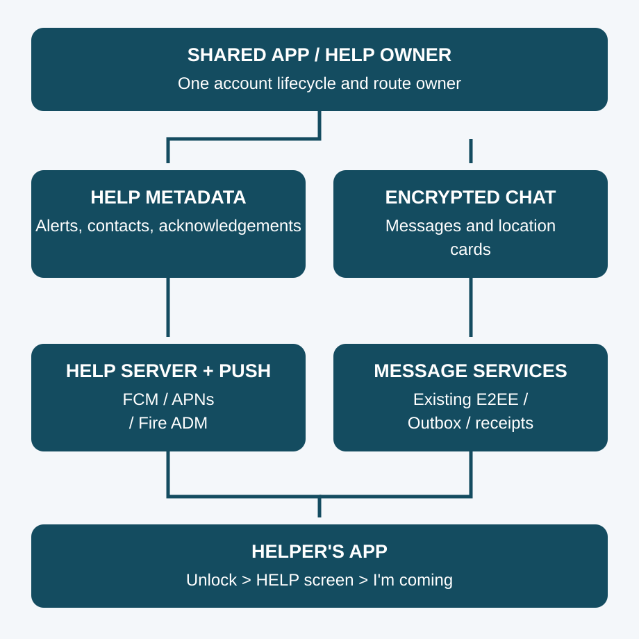

# FIDUNIO HELP — program documentation

Documentation snapshot: **1.1.88**, 28 November 2026. This describes the implementation, its boundaries and the evidence available at this date. It is not an authorization to refactor or deploy the runtime.

## Sources and release evidence

- Production web source: `main` at `8fbd148ceb296297fdc995e374263e4319a09b36`.
- iOS release source: `c25fd5cbd49b84eeb4bbee4463e2a4e413088c0f`; current iOS head `79fe533261d6045bf88ec979036e499c9278e65c` includes later App Review tooling changes.
- Android APK source: `28a7ad716644d1d523b73d86fc31fd2379c0a887`; branch head `c0d7c75989e7da6574ea1c4c9233e60101ccf6d7` includes the APK result record.
- Work branches: `fix/nov24-ios`, `fix/nov24-android`, `fix/nov24-web`. Release authorities remain `ios`, capital-`Android`, and `main`. `main-3` and `main2` are retired notices.
- Web Pages run `46079882799`, main security run `46079884194`, iOS TestFlight run `46079874858`, and Android signed APK run `46079879409` completed successfully.
- Cuberoot's `downloads/fidunio-build.json` confirms the signed APK from run `46079879409` was published on 27 November at 23:04:06 UTC. Current source version is 1.1.88. App Store public approval is a separate status from TestFlight processing.

## Read before changing HELP

Read root `hermes-memory.txt`, `CODING-GUIDELINES.md`, `CURRENT-REBUILD.md`, `README.md`, `FIDUNIO-BUILD-CHECKLIST.md`, `FCM-NOTIFICATION-ARCHITECTURE.md`, `DETERMINISTIC-UI-LIFECYCLE.md`, `RUNTIME-AUTHORITY-MAP.md`, `architecture-ownership.txt`, defect documents, and `ios/NOV25-REBUILD-PLAN.md` at the relevant branch revisions. Recover the current repository first. Never infer a new architecture from this guide alone.

The binding rule remains one resource, one owner, one predefined area and one serialized mutation path. Shared messaging, encryption, receipts, subscription and lifecycle processes remain common to iPhone and iPad. Platform capabilities belong in same-named adapters. Document actual code separately from the desired contract when they disagree.

## Illustrated user state flow

1. `helpSettings/{uid}` stores up to five chosen helpers. Saving no helpers disables the sender's HELP bar.
2. A two-second hold creates one server-backed `helpAlerts` document in state `open` with empty acknowledgements.
3. The UI shows HELP is sent only after alert creation succeeds. Location acquisition and the encrypted HELP card follow separately.
4. A helper appends only its own acknowledgement. The sender sees the helper's display name and a green response screen. The alert remains open, but further alarm reminders stop when any acknowledgement exists.
5. The sender chooses I'm OK now. The alert becomes `safe`, the encrypted OK card goes through the existing chat, and the UI returns to Messages.
6. Rules also allow the sender's `cancelled` terminal state for compatibility; the simplified current UI uses `safe`.

## Owners, resources and dependencies

| Resource / area | Current code owner | Entry and serialization | Consumers |
|---|---|---|---|
| HELP account state, contacts and alert projections | `help-owner.js:createHelpOwner` | `start(uid)` / `stop()`; generation guards, one confirmation-read promise chain | HELP bar, screens, Settings HELP card |
| App route, existing conversation and message projection | `app.js` | Existing activation and chat/message owners; injected HELP chat capabilities | Ordinary chat and large HELP view |
| HELP screen host | HELP owner, invoked by the central app renderer | `renderHelp`, `renderHelpAlert`, `backgroundRefresh` | Sender and helper screens |
| Messages HELP bar / reminder hosts | Structural app renderer creates `#helpBarSlot` and `#helpNoticeSlot`; HELP owner projects inside them | `refreshBar()` on both structural and background app projection | Phone and iPad sidebar |
| Settings page and named HELP host | `settings-lifecycle.js` / existing app Settings path | One page lifecycle; server-backed children awaited in order; `refreshSettingsCard` skips contact selection | Settings > Safety > HELP |
| HELP chat watch and text send | HELP owner delegates to existing app chat capabilities | `watchQueue` and `queueSend`; `chat.watch`, `sendDirect`, `sendGroup`, `ensureGroup`, `retry` | Same encrypted message rows in both views |
| Firebase app/services | `firebase.js` initializes and supplies `getFirebaseServices` | Existing account lifecycle; no extra HELP auth listener | HELP and established message services |
| Device location and system notification settings | `help-platform-adapter.js` | `currentLocation()` returns `{lat,lng,acc}` or null; `openNotificationSettings()` | HELP cards / permission reminder |
| HELP alert delivery and reminder policy | `functions-help/help-core.mjs` | `alertCreated`, `alertUpdated`, `sweep`, existing server repository adapter | FCM / APNs / ADM recipients |
| Device lease checks and server data access | `functions-help/help-firestore-admin.mjs` | Authorized server identity, notification token owner/lease checks | HELP push sender |
| Native alarm and notification tap mechanics | iOS build/native services; Android `FidunioAdmService` / plugin | Platform-specific delivery intent is handed to shared route logic | HELP owner and app activation |

These are descriptions of current code. The HELP owner uses Firestore operations from the services returned by `firebase.js` directly; it has not yet been moved behind a dedicated repository method in `firebase.js`. Do not claim that every HELP database write already follows the older sole-Firebase-writer rule.

## Illustrated data and delivery boundaries

HELP operational records and encrypted conversation content are different resources. `helpAlerts` contains sender/helper account identifiers, state, acknowledgement times and server timestamps. It contains no location or message text. `helpReach` records notification availability per installation. These records are not the E2EE message payload.

The existing direct/group message owner encrypts HELP cards and typed text. A card is a versioned `fidunioHelp:1` JSON object inside the encrypted message body. Location, when available, is `{lat,lng,acc}` inside that encrypted card. The server does not decrypt cards or manufacture message rows or receipts.

HELP notifications expose short operational status and display names by design. Their routing data is `type:help-alert`, opaque `alertId`, status `kind`, and bounded `notificationBody`. They exclude conversation text, attachment content, location coordinates, keys, password, PIN and recovery material. Ordinary direct/group push retains its existing transport-only contract.

## Client function reference

| Function | Purpose / boundary |
|---|---|
| `encodeHelpCard`, `parseHelpCard` | Encode/recognize the versioned encrypted-body HELP descriptor. Allowed card kinds include alert, contact, coming, safe and legacy cancel/note. |
| `mapLink`, `helpCardLines`, `renderHelpCardBubble`, `helpPreview` | Pure presentation helpers. Maps link is emitted only for finite coordinates; rendered text is escaped. |
| `start`, `stop` | Start once for an account; release watchers, drafts and state on stop/account switch. Duplicate same-account auth reports do not reset chosen contacts. |
| `saveHelpers` | Deduplicate helpers, exclude self, limit to five, await the settings write, update confirmed local projection; maintain the existing HELP conversation and contact cards. |
| `sendAlert` | Guard repeated holds, await the open alert write, then acquire location and queue its encrypted chat card. Failure remains explicit. Alert success is not proof of push delivery. |
| `imComing` | Await the helper's own acknowledgement write, then queue the encrypted response card. |
| `imOk` | Await the sender's `safe` transition and queue the OK card before returning to Messages. |
| `openUnanswered`, `afterUnlock` | Present an incoming unacknowledged alert when unlocked; reset presentation bookkeeping after unlock. |
| `viewForAlert`, `viewForConversation` | Resolve notification intent to HELP or normal chat using current server-backed alerts. |
| `freshAlerts` | Query outgoing and incoming open alerts, with an eight-second completion bound. This is the 1.1.88 fix for stale resumed lists. |
| `refreshBar`, `bindShared` | Project and bind only the named HELP bar/reminder slots, including the iPad background-render path. |
| `watchChat`, `chatLines`, `chatPanel`, `bindChatPanel` | Watch the existing chat, project recent HELP-related rows and preserve the textarea. Attachments show labels here; ordinary chat opens their contents. |
| `queueSend`, `deliverPending` | Run HELP text/card work in order using the existing app message/Outbox capabilities. Failed rows expose retry controls. |
| `renderHelp`, `renderHelpAlert`, `backgroundRefresh` | Sender hold/red/green screens and helper alert/chat screen; update chat projection without replacing a stable active composer. |
| `mountSettingsCard`, `refreshSettingsCard` | Collapsed contact chooser, Save/Cancel and notification reachability; skip refresh while the chooser is active. |
| `refreshReach`, `leaveReach`, `loadReach`, `reachNote` | Publish this installation's notification status, remove it at sign-out, read helper availability and show warnings. Availability is not delivery proof. |
| `noticeMarkup`, `turnOnNotifications` | Show the enabled HELP sender/contact reminder while notifications are off; request permission or open OS settings. |

## Server function reference

Server source is retained on capital-`Android` under the separate `functions-help` codebase. Do not deploy or copy it from a stale branch simply because a web document links to it.

| Function / module | Behavior |
|---|---|
| `helpers` | Normalize and bound recipients, excluding the sender. |
| `alertBody`, `newAcks`, `realertDue` | Bound public text; detect new helper answers; allow reminder only while open, unanswered and due. |
| `createHelpCore.alertCreated` | Revalidate helper membership against saved settings, resolve sender display name, send to authorized devices and record reminder timestamps. |
| `createHelpCore.alertUpdated` | Notify sender/other helpers of new acknowledgements; notify helpers of safe/cancelled closure. |
| `createHelpCore.sweep` | Two reminder passes, 30 seconds apart, scheduled each minute; bounded cleanup of alert metadata older than 30 days. No message-content purge is performed here. |
| `createHelpFirestoreRepo` | Read settings/profile/device records, validate token lease ownership, mark delivery attempts and query/purge bounded alert pages. |
| `helpFcmMessage` / `createHelpPush` | FCM/APNs/web routing plus ADM for Fire; own alarm sound/channel for alert kind; ordinary sound for updates; APNs collapse identifier per alert. |
| `helpAlertCreatedV1`, `helpAlertUpdatedV1`, `helpAlertSweepV1` | Gen2 trigger and scheduler exports in `us-central1`; dedicated notification runtime identity. Existing message/recovery codebases stay independent. |

## Rules and privacy

- `helpSettings/{uid}`: owner writes their own helper list and server timestamp. Chosen helpers can query settings that include their account.
- `helpAlerts/{id}`: sender creates a valid open alert using configured helpers. Only sender/helpers read it. A helper may append only their own acknowledgement; the sender may close it to safe/cancelled. Clients cannot delete it.
- `helpReach/{uid}`: each account updates its own per-device availability map, at most 20 entries; registered accounts may get a known record but may not list the collection.
- Short notification status and sender/helper names are OS-visible. Location remains within E2EE chat. Opening a map intentionally hands coordinates to the external map provider.
- The 30-day server cleanup applies to HELP metadata. It does not certify deletion of regular chat, attachments or local history.

## Lifecycle and routing details

The central signed-in report starts notification upkeep, conversations, blocked users, groups, HELP, activation and key publication once in the recorded order. HELP receives services through `getFirebaseServices` and must not add an auth initializer.

In 1.1.88 a notification path calls the HELP route resolver before selecting ordinary chat. `loaded()` waits for initial incoming/outgoing list readiness, then `freshAlerts()` requests current server records with an eight-second bound. Matching outgoing alerts choose `help`; incoming alerts choose `helpAlert`; absent/closed alerts continue to the ordinary route. This avoids making an already-loaded but stale listener list the final authority after resume.

The current code still contains `loaded()` polling, a listener-error restart timeout, a two-second user hold timer, an eight-second request bound, and short status-display timers. The hold gesture and request bound serve explicit interaction/failure purposes; polling and automatic listener restart require a separate review against the no-timer-repair guideline. This documentation task does not change or approve those mechanisms. The server's scheduled reminder interval is product behavior, not a DOM repair strategy.

Settings remains one integrated page. Background E2EE/HELP work does not rebuild it; the HELP card refreshes only inside its named host and not while contacts are being chosen. The iPad partial-chat projection must also update the separate HELP bar slot. Do not add observers, rotation repair or a separate iPad message stream.

## Evidence and remaining acceptance

The evidence branch snapshot `9d9d0950ffdad9a15e352b055ab60a9371a01a5a` contains real simulator screenshots with fictional accounts. They are teaching examples; they do not prove every end-to-end notification path.

- Android report: startup once, Copy/Select Text, link confirmation, rich input, Back/grace, HELP setup/send/respond/closure, background/restart and notification routing all report expected results.
- iPad report: HELP bar arrives on the two-pane layout; three restart/unlock checks passed; Settings filled after 1.7 seconds with zero rebuilds while open; incoming HELP resume passed.
- iPhone report: major HELP journeys and the chat-notification-first case passed, but plain Paste was unavailable to the simulator touch layer; three notification banner-tap checks failed to bring the app forward, and the reachability-card check timed out. Preserve these failures rather than calling the whole matrix green.
- Notification permission in the simulator can be granted while APNs registration still fails; the report shows the explicit missing-token error. This is not live APNs delivery acceptance.
- Owner real-device acceptance of the final 1.1.88 route fix remains distinct from simulator and release-gate results.
- Apple Critical Alerts entitlement approval is pending. No claim of bypassing silent mode/Focus is supported. HELP App Review recording and precise-location App Store disclosure remain tracked work.
- Lost iPad local PIN record cause remains unproven because the installation was deleted before evidence capture. Never reset an affected installation before preserving evidence and recovery material.

## Required regression coverage for any future HELP change

Setup Save/Cancel and repeated saves; one/five/zero helpers; self/unauthorized access denial; startup once and account switch; two-second hold versus quick tap; alert-create failure; location denied/late; helper acknowledgement/OK closure; existing direct chat in both member orders; multiple-helper group membership; same ordered messages in ordinary/large views; draft preservation and failed-text retry; stale notification list on resume; HELP alarm/chat-first/chat-after-close routing; cold Android intent; iPad two-pane restart/PIN; dark mode and A/A+/A++; notification denial and reachability; sign-out lease/reachability cleanup; ordinary messaging, E2EE, receipts and Outbox regression.

Run behavior tests on the exact source and record each PASS/FAIL/UNTESTED separately. TestFlight VALID, APK signing and a successful Pages deployment do not certify physical-device acceptance.
