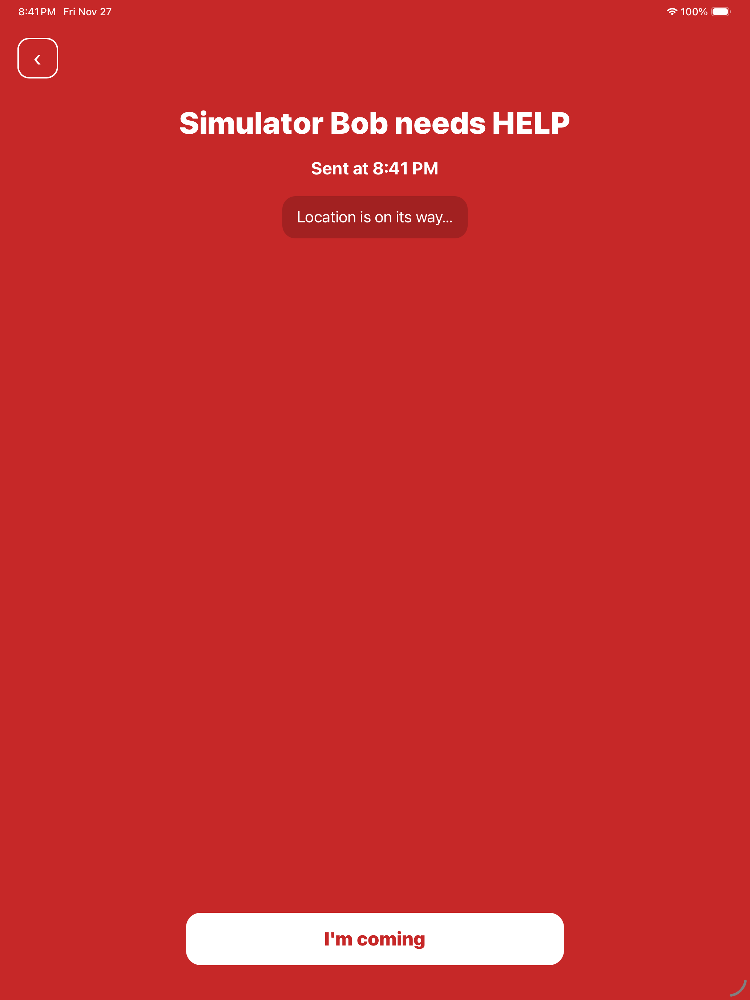

# FIDUNIO input probe — ios iPad — fix

| Check | What | Expected | Observed | |
|---|---|---|---|---|
| STARTUP-ONCE | After sign-in, count how many times each start-up step started | every step exactly once, in order | order: notification upkeep → conversations → blocked users → groups → HELP → activation → publish E2EE key / counts: {"notification upkeep":1,"conversations":1,"blocked users":1,"groups":1,"HELP":1,"activation":1,"publish E2EE key":1} | as expected |
| IPAD-LAYOUT | iPad simulator, chat with Bob open | two-panel layout (list on the left, chat on the right) | two-panel with chat open | as expected |
| IPAD-BAR-LIVE | With the chat open, HELP contacts arrive from the server (Bob chosen on another device); touch nothing | the red HELP bar appears in the left panel within 20 s, without touching anything | HELP bar shown; still in chat: true; trace ["20:37:46 settings snapshot exists=false cache=false pending=false contacts=-","20:37:46 settings applied (server read) contacts=0","20:37:46 reach saved false","20:37:46 HELP contact of 0","20:38:19 settings snapshot exists=true cache=false pending=false contacts=1","20:38:19 settings applied (server read) contacts=1","20:38:19 bar redrawn shown","20:38:19 notice shown"] | as expected |
| IPAD-BAR-RESTART-1 | Restart FIDUNIO, unlock with the PIN, touch nothing (round 1 of 3) | the red HELP bar is there within 20 s, without touching anything | unlocked: true; HELP bar shown; route: messages; trace ["20:38:51 start","20:38:51 stop","20:38:51 settings snapshot exists=true cache=false pending=false contacts=1","20:38:51 settings applied (server read) contacts=1","20:38:51 bar redrawn shown","20:38:51 notice shown","20:38:51 reach saved false","20:38:51 HELP contact of 0"] | as expected |
| IPAD-BAR-RESTART-2 | Restart FIDUNIO, unlock with the PIN, touch nothing (round 2 of 3) | the red HELP bar is there within 20 s, without touching anything | unlocked: true; HELP bar shown; route: messages; trace ["20:39:32 start","20:39:32 stop","20:39:33 settings snapshot exists=true cache=false pending=false contacts=1","20:39:33 settings applied (server read) contacts=1","20:39:33 bar redrawn shown","20:39:33 notice shown","20:39:33 reach saved false","20:39:33 HELP contact of 0"] | as expected |
| IPAD-BAR-RESTART-3 | Restart FIDUNIO, unlock with the PIN, touch nothing (round 3 of 3) | the red HELP bar is there within 20 s, without touching anything | unlocked: true; HELP bar shown; route: messages; trace ["20:40:07 start","20:40:07 stop","20:40:08 settings snapshot exists=true cache=false pending=false contacts=1","20:40:08 settings applied (server read) contacts=1","20:40:08 bar redrawn shown","20:40:08 notice shown","20:40:08 reach saved false","20:40:08 HELP contact of 0"] | as expected |
| IPAD-SETTINGS-FILL | Restart FIDUNIO, unlock, open Settings at once; touch nothing else | every part of Settings filled; the page is never rebuilt while loading | filled after 1.9 s; page rebuilt while open: 0 time(s); still filled 8 s later: true | as expected |
| IPAD-HELP-RESUME | Bob sends HELP to Alice while FIDUNIO is in the background (Home screen); Alice opens FIDUNIO again and taps nothing | the red "Simulator Bob needs HELP" screen is there by itself | screen: helpAlert "‹ Simulator Bob needs HELP Sent at 8:41 PM Location is on it"; HELP trace ["20:40:44 settings applied (server read) contacts=1","20:40:44 bar redrawn shown","20:40:44 notice shown","20:40:44 reach saved false","20:40:44 HELP contact of 0","20:40:48 settings card contacts=1","20:40:48 settings card contacts=1","20:41:32 HELP contact of 1"] | as expected |

### IPAD-LAYOUT — 02-ipad-two-panel.png

### IPAD-BAR-LIVE — 03-ipad-bar-live.png

### IPAD-BAR-RESTART-1 — 04-ipad-bar-restart-1.png

### IPAD-BAR-RESTART-2 — 05-ipad-bar-restart-2.png

### IPAD-BAR-RESTART-3 — 06-ipad-bar-restart-3.png

### IPAD-SETTINGS-FILL — 07-ipad-settings-filled.png

### IPAD-HELP-RESUME — 08-ipad-help-resume.png

