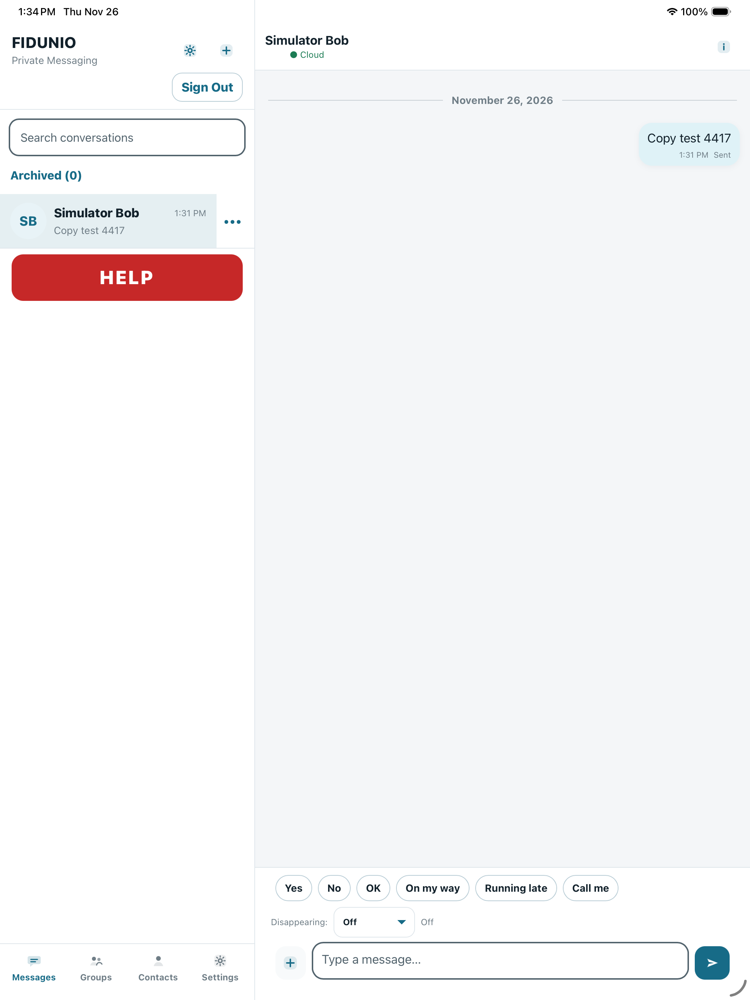

# FIDUNIO input probe — ios iPad — fix

| Check | What | Expected | Observed | |
|---|---|---|---|---|
| STARTUP-ONCE | After sign-in, count how many times each start-up step started | every step exactly once, in order | order: notification upkeep → conversations → blocked users → groups → HELP → activation → publish E2EE key / counts: {"notification upkeep":1,"conversations":1,"blocked users":1,"groups":1,"HELP":1,"activation":1,"publish E2EE key":1} | as expected |
| IPAD-LAYOUT | iPad simulator, chat with Bob open | two-panel layout (list on the left, chat on the right) | two-panel with chat open | as expected |
| IPAD-BAR-LIVE | With the chat open, HELP contacts arrive from the server (Bob chosen on another device); touch nothing | the red HELP bar appears in the left panel within 20 s, without touching anything | HELP bar shown; still in chat: true; trace ["13:31:32 start","13:31:32 stop","13:31:33 settings snapshot exists=false cache=false pending=false contacts=-","13:31:33 settings applied (server read) contacts=0","13:32:37 settings snapshot exists=true cache=false pending=false contacts=1","13:32:37 settings applied (server read) contacts=1","13:32:37 bar redrawn shown"] | as expected |
| IPAD-BAR-RESTART-1 | Restart FIDUNIO, unlock with the PIN, touch nothing (round 1 of 3) | the red HELP bar is there within 20 s, without touching anything | unlocked: true; HELP bar shown; route: messages; trace ["13:33:15 start","13:33:15 stop","13:33:15 settings snapshot exists=true cache=false pending=false contacts=1","13:33:15 settings applied (server read) contacts=1","13:33:15 bar redrawn shown"] | as expected |
| IPAD-BAR-RESTART-2 | Restart FIDUNIO, unlock with the PIN, touch nothing (round 2 of 3) | the red HELP bar is there within 20 s, without touching anything | unlocked: true; HELP bar shown; route: messages; trace ["13:34:02 start","13:34:02 stop","13:34:02 settings snapshot exists=true cache=false pending=false contacts=1","13:34:02 settings applied (server read) contacts=1","13:34:02 bar redrawn shown"] | as expected |
| IPAD-BAR-RESTART-3 | Restart FIDUNIO, unlock with the PIN, touch nothing (round 3 of 3) | the red HELP bar is there within 20 s, without touching anything | unlocked: true; HELP bar shown; route: messages; trace ["13:34:44 start","13:34:44 stop","13:34:44 settings snapshot exists=true cache=false pending=false contacts=1","13:34:44 settings applied (server read) contacts=1","13:34:44 bar redrawn shown"] | as expected |

### IPAD-LAYOUT — 02-ipad-two-panel.png

### IPAD-BAR-LIVE — 03-ipad-bar-live.png

### IPAD-BAR-RESTART-1 — 04-ipad-bar-restart-1.png

### IPAD-BAR-RESTART-2 — 05-ipad-bar-restart-2.png

### IPAD-BAR-RESTART-3 — 06-ipad-bar-restart-3.png

