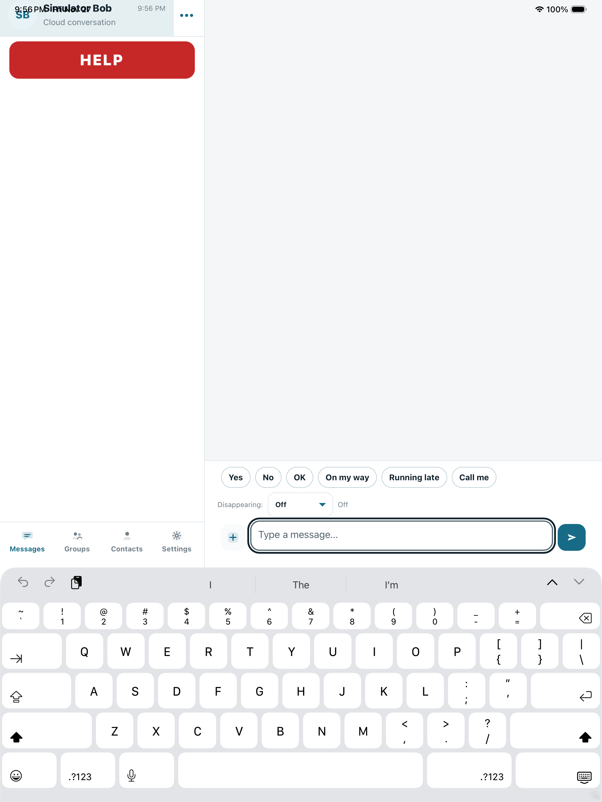
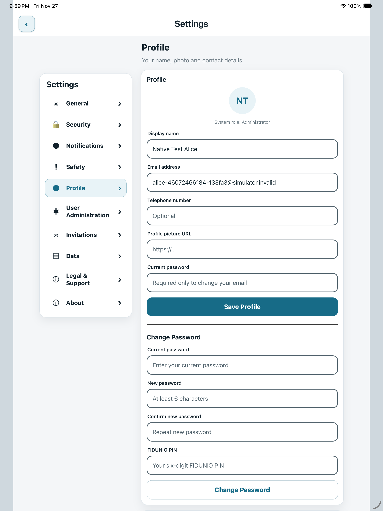

# FIDUNIO input probe — ios iPad — fix

| Check | What | Expected | Observed | |
|---|---|---|---|---|
| STARTUP-ONCE | After sign-in, count how many times each start-up step started | every step exactly once, in order | order: notification upkeep → conversations → blocked users → groups → HELP → activation → publish E2EE key / counts: {"notification upkeep":1,"conversations":1,"blocked users":1,"groups":1,"HELP":1,"activation":1,"publish E2EE key":1} | as expected |
| IPAD-LAYOUT | iPad simulator, chat with Bob open | two-panel layout (list on the left, chat on the right) | two-panel with chat open | as expected |
| IPAD-BAR-LIVE | With the chat open, HELP contacts arrive from the server (Bob chosen on another device); touch nothing | the red HELP bar appears in the left panel within 20 s, without touching anything | HELP bar shown; still in chat: true; trace ["21:56:05 settings snapshot exists=false cache=false pending=false contacts=-","21:56:05 settings applied (server read) contacts=0","21:56:05 reach saved false","21:56:05 HELP contact of 0","21:56:42 settings snapshot exists=true cache=false pending=false contacts=1","21:56:42 settings applied (server read) contacts=1","21:56:42 bar redrawn shown","21:56:42 notice shown"] | as expected |
| IPAD-BAR-RESTART-1 | Restart FIDUNIO, unlock with the PIN, touch nothing (round 1 of 3) | the red HELP bar is there within 20 s, without touching anything | unlocked: true; HELP bar shown; route: messages; trace ["21:57:28 start","21:57:28 stop","21:57:28 settings snapshot exists=true cache=false pending=false contacts=1","21:57:28 settings applied (server read) contacts=1","21:57:28 bar redrawn shown","21:57:28 notice shown","21:57:29 reach saved false","21:57:29 HELP contact of 0"] | as expected |
| IPAD-BAR-RESTART-2 | Restart FIDUNIO, unlock with the PIN, touch nothing (round 2 of 3) | the red HELP bar is there within 20 s, without touching anything | unlocked: true; HELP bar shown; route: messages; trace ["21:58:03 start","21:58:03 stop","21:58:03 settings snapshot exists=true cache=false pending=false contacts=1","21:58:03 settings applied (server read) contacts=1","21:58:03 bar redrawn shown","21:58:03 notice shown","21:58:03 reach saved false","21:58:03 HELP contact of 0"] | as expected |
| IPAD-BAR-RESTART-3 | Restart FIDUNIO, unlock with the PIN, touch nothing (round 3 of 3) | the red HELP bar is there within 20 s, without touching anything | unlocked: true; HELP bar shown; route: messages; trace ["21:58:40 start","21:58:40 stop","21:58:41 settings snapshot exists=true cache=false pending=false contacts=1","21:58:41 settings applied (server read) contacts=1","21:58:41 bar redrawn shown","21:58:41 notice shown","21:58:41 reach saved false","21:58:42 HELP contact of 0"] | as expected |
| IPAD-SETTINGS-FILL | Restart FIDUNIO, unlock, open Settings at once; touch nothing else | every part of Settings filled; the page is never rebuilt while loading | filled after 1.4 s; page rebuilt while open: 0 time(s); still filled 8 s later: true | as expected |
| IPAD-HELP-RESUME | Bob sends HELP to Alice while FIDUNIO is in the background (Home screen); Alice opens FIDUNIO again and taps nothing | the red "Simulator Bob needs HELP" screen is there by itself | screen: helpAlert "‹ Simulator Bob needs HELP Sent at 9:59 PM Location is on it"; HELP trace ["21:59:17 settings applied (server read) contacts=1","21:59:17 bar redrawn shown","21:59:17 notice shown","21:59:18 reach saved false","21:59:18 HELP contact of 0","21:59:21 settings card contacts=1","21:59:21 settings card contacts=1","21:59:58 HELP contact of 1"] | as expected |

### IPAD-LAYOUT — 02-ipad-two-panel.png

### IPAD-BAR-LIVE — 03-ipad-bar-live.png

### IPAD-BAR-RESTART-1 — 04-ipad-bar-restart-1.png

### IPAD-BAR-RESTART-2 — 05-ipad-bar-restart-2.png

### IPAD-BAR-RESTART-3 — 06-ipad-bar-restart-3.png

### IPAD-SETTINGS-FILL — 07-ipad-settings-filled.png

### IPAD-HELP-RESUME — 08-ipad-help-resume.png

