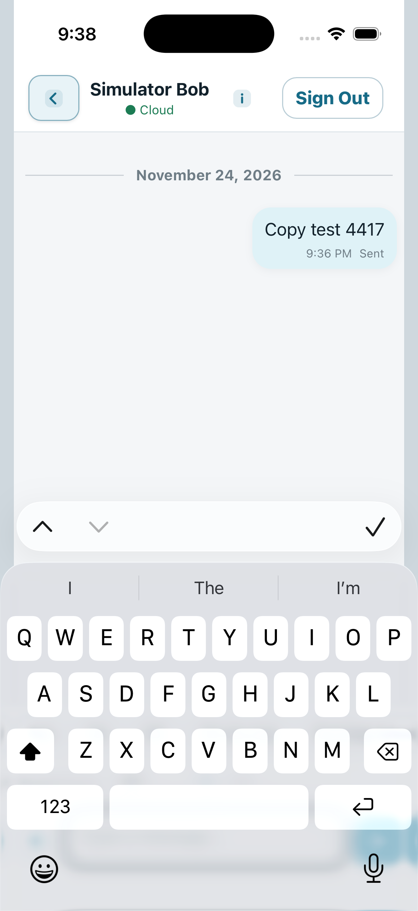
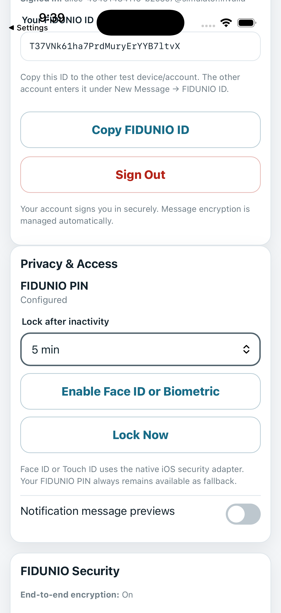
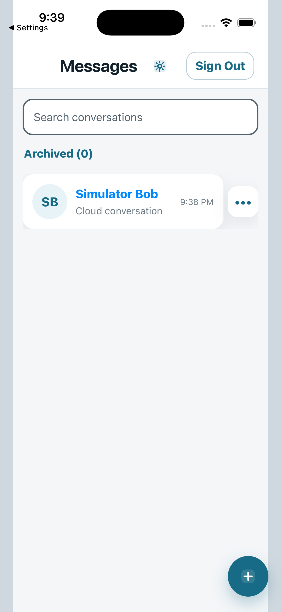
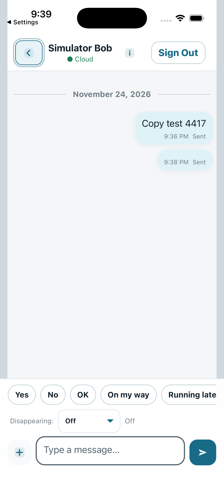
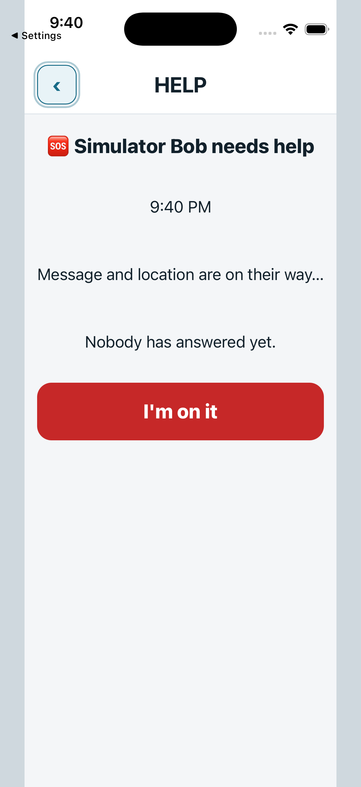
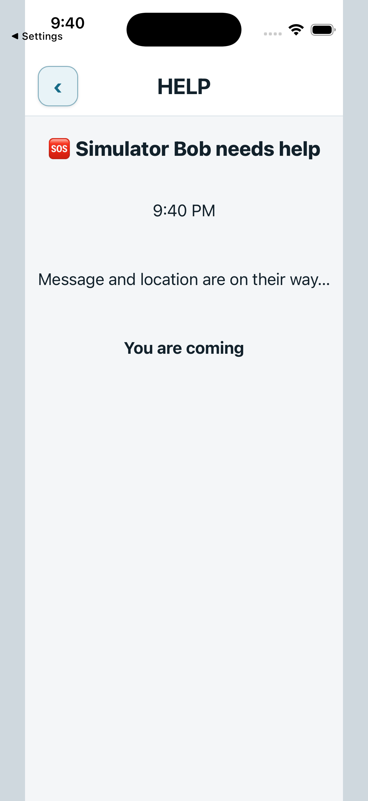
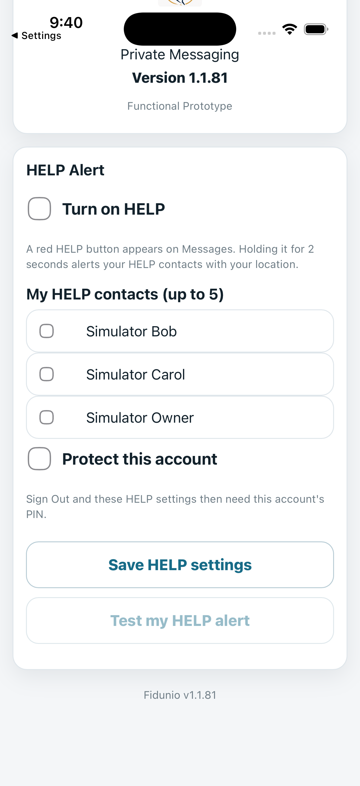
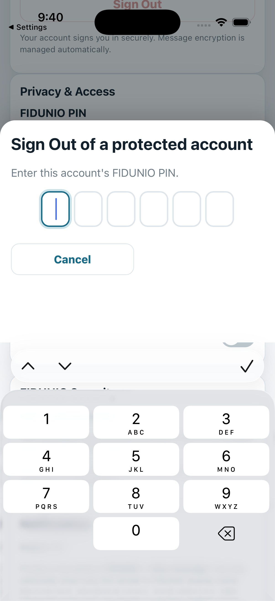

# FIDUNIO input probe — ios — fix

| Check | What | Expected | Observed | |
|---|---|---|---|---|
| COPY | Press and hold a message, tap Copy | sheet offers Copy; the phone clipboard then holds the message text | Copy button present; clipboard now: "Copy test 4417" | as expected |
| SELECT-TEXT | Press and hold a message, Select Text, press and hold one word, tap Copy, then Done | only that word is copied; Done goes back to the same chat | marked: "Copy"; copied: "Copy"; after Done: same chat | as expected |
| PASTE | Press and hold the message box, tap the phone's Paste | the copied text appears in the message box | simulator clipboard set; NO Paste found by the touch layer; message box now: "" | **DIFFERENT** |
| PICTURE-PASTE | A paste that carries a picture (what an iPhone sticker sends) | FIDUNIO sends it as a photo | a new message appeared ( 9:38 PM Sent ) | as expected |
| GRACE | Switch to another app for ~15 s, then back | FIDUNIO opens unlocked (5 min grace) | unlocked | as expected |
| HELP-SETTINGS | Settings → HELP Alert: Turn on, tick Simulator Bob, Save | "Saved."; the server has HELP on with Bob as the only contact | screen: "Saved."; server: no HELP settings saved | **DIFFERENT** |
| HELP-BUTTON | Back to Messages | a red HELP button is on the Messages screen | no HELP button | **DIFFERENT** |
| HELP-QUICK-TAP | HELP screen: a quick tap on the big button (not held) | nothing is sent (it needs a 2-second hold) | TEST ERROR: #helpFab not on screen | **DIFFERENT** |
| HELP-SEND | Press and hold the HELP button for 3 seconds; allow location when the phone asks | "Help alert sent", a Cancel button, and the server has an open alert for Bob | TEST ERROR: Cannot read properties of null (reading 'x') | **DIFFERENT** |
| HELP-PICTURE | Tap the "I'm hurt" picture button | the button marks as sent | no picture buttons | **DIFFERENT** |
| HELP-ACK | Bob answers "I'm on it" (from his phone) | Alice's HELP screen shows "Simulator Bob is coming" | no alert to answer | **DIFFERENT** |
| HELP-CHAT-CARDS | Open the chat with Bob | HELP cards in the chat: the alert with "Open location on a map", and "I'm hurt" | NO map link; chat text: November 24, 2026 Copy test 4417 9:36 PM Sent 9:38 PM Sent  | **DIFFERENT** |
| HELP-SAFE | Open the HELP alert from the banner, tap "I'm safe now" | the alert closes (server: safe); HELP screen is back to the big button | TEST ERROR: .help-banner not on screen | **DIFFERENT** |
| HELP-INCOMING | Bob sends HELP to Alice (from his phone) | Alice's FIDUNIO opens "Simulator Bob needs help" by itself; "I'm on it" tells the server | opened: "🆘 Simulator Bob needs help"; server: Alice is on it | as expected |
| HELP-TEST | Settings → "Test my HELP alert", then "Cancel — it was a mistake" | TEST alert sent, then cancelled (server: cancelled) | screen: "no Cancel button seen"; server: no test alert | **DIFFERENT** |
| HELP-PROTECT | Settings: tick "Protect this account", Save (asks PIN), then try Sign Out | PIN asked to protect; Sign Out then asks the PIN, and Cancel keeps Alice signed in | PIN asked to protect: true; server protected=true; Sign Out asked PIN: true; after Cancel still signed in: true | as expected |

### COPY — 02-copy-sheet.png

### SELECT-TEXT — 03-select-text-marked.png

### SELECT-TEXT — 04-select-text-done.png

### PASTE — 06-after-paste.png

### PICTURE-PASTE — 07-picture-paste.png

### GRACE — 08-back-after-15s.png

### HELP-SETTINGS — 09-help-settings-saved.png

### HELP-BUTTON — 10-help-fab.png

### HELP-PICTURE — 13-help-pictures.png

### HELP-CHAT-CARDS — 14-help-chat-cards.png

### HELP-INCOMING — 16-help-incoming.png

### HELP-INCOMING — 17-help-onit.png

### HELP-TEST — 18-help-test-cancelled.png

### HELP-PROTECT — 19-help-protect-signout.png

