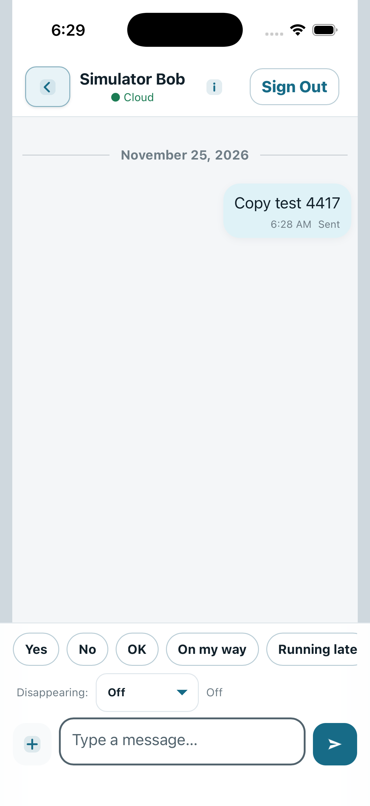
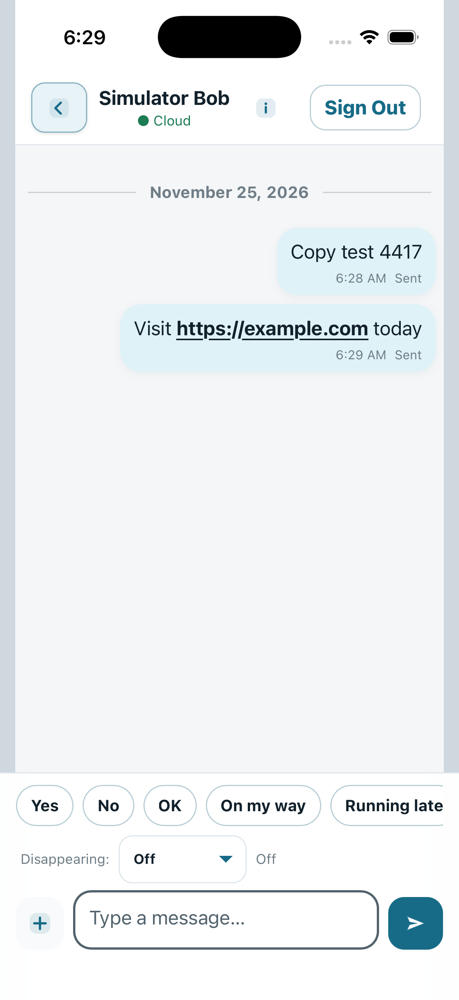
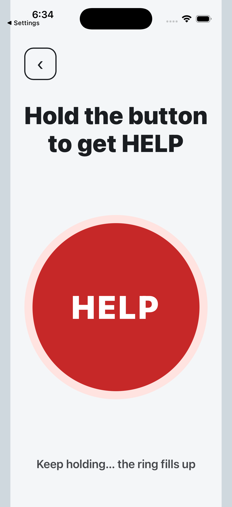
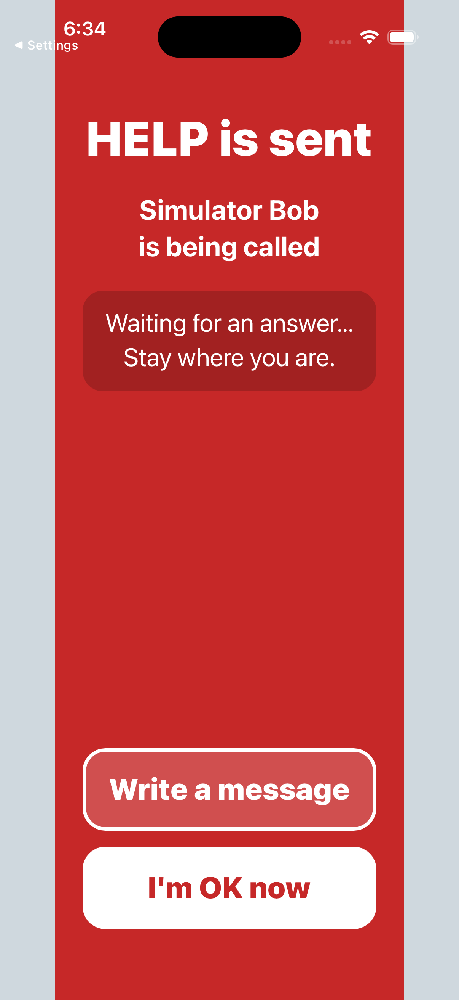
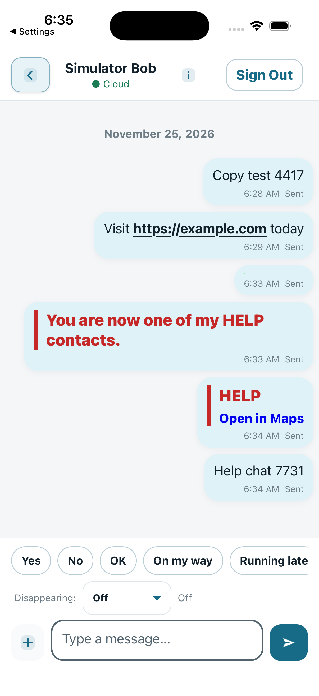
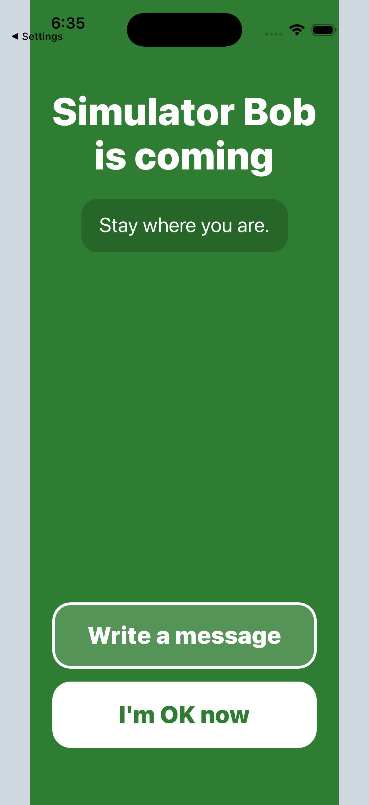
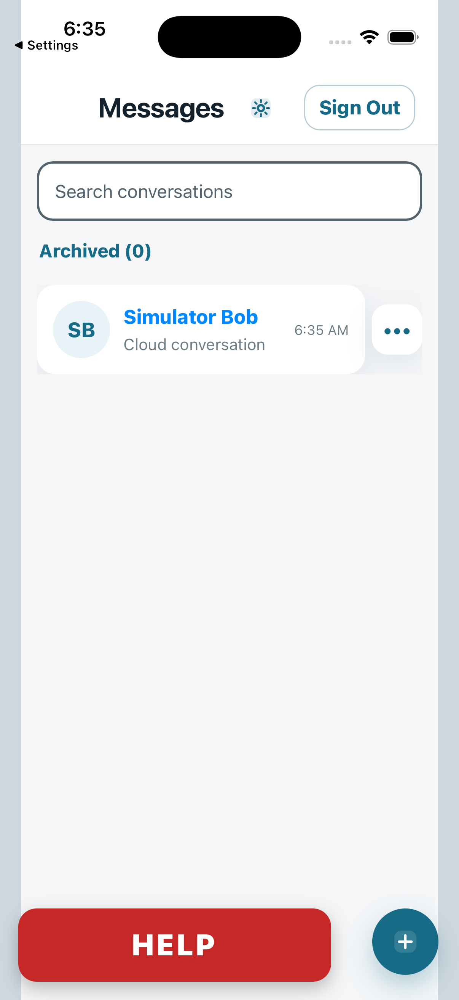
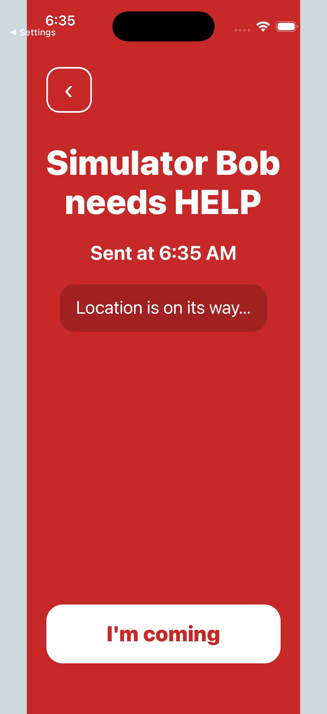
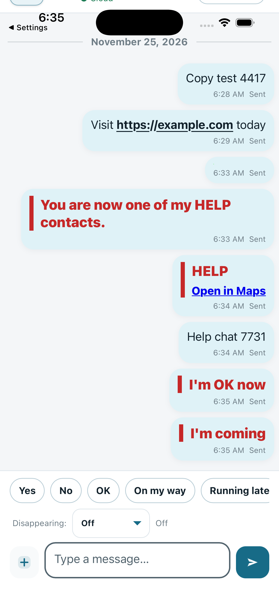
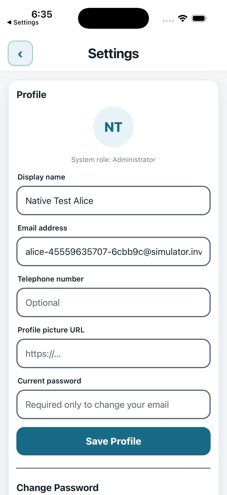

# FIDUNIO input probe — ios — fix

| Check | What | Expected | Observed | |
|---|---|---|---|---|
| COPY | Press and hold a message, tap Copy | sheet offers Copy; the phone clipboard then holds the message text | Copy button present; clipboard now: "Copy test 4417" | as expected |
| SELECT-TEXT | Press and hold a message, Select Text, press and hold one word, tap Copy, then Done | only that word is copied; Done goes back to the same chat | marked: "Copy"; copied: "Copy"; after Done: same chat | as expected |
| LINK | Send "Visit https://example.com today", tap the link: Cancel, then tap again: Open | "Open this link?" first; Cancel stays in the chat; Open shows the web page outside FIDUNIO | asked first: true; Cancel stayed in chat: true; after Open: still in FIDUNIO | **DIFFERENT** |
| PASTE | Press and hold the message box, tap the phone's Paste | the copied text appears in the message box | simulator clipboard set; NO Paste found by the touch layer; message box now: "" | **DIFFERENT** |
| PICTURE-PASTE | A paste that carries a picture (what an iPhone sticker sends) | FIDUNIO sends it as a photo | a new message appeared ( 6:33 AM Sent ) | as expected |
| GRACE | Switch to another app for ~15 s, then back | FIDUNIO opens unlocked (5 min grace) | unlocked | as expected |
| HELP-SETTINGS | Settings → HELP: the contacts list is closed; tap "Choose HELP contacts", tick Simulator Bob, Save | list closed at first; "Saved."; the server has Bob as the only HELP contact | list closed at first: true; screen: "Saved.", "HELP contacts: Simulator Bob"; server: enabled=true, contacts=1 | as expected |
| HELP-BAR | Back to Messages | one red HELP bar on the Messages screen, no banners | HELP bar shown; banners: none | as expected |
| HELP-QUICK-TAP | HELP screen: a quick tap on the big button (not held) | nothing is sent (it needs a 2-second hold) | nothing sent | as expected |
| HELP-SEND | Press and hold the HELP button for 3 seconds; allow location when the phone asks | red "HELP is sent — Simulator Bob is being called", "Write a message", "I'm OK now"; server has an open alert for Bob | screen: "HELP is sent Simulator Bob is being called Waiting for an answer… Stay where you are. Write a message I'm OK now"; location prompts answered: Allow Once, Allow; server: open alert for Bob | as expected |
| HELP-WRITE | Tap "Write a message", type and send "Where are you?" | the HELP chat with Bob opens, with the HELP card and the map link; the message is sent | chat: ""; map link shown; text: oday 6:29 AM Sent 6:33 AM Sent You are now one of my HELP contacts. 6:33 AM Sent HELP Open in Maps 6:34 AM Sent Help chat 7731 6:34 AM Sent  | as expected |
| HELP-COMING-SEEN | Bob answers "I'm coming" (from his phone); Alice opens the HELP bar | green "Simulator Bob is coming", "Write a message", "I'm OK now" | bar said: "HELP is on — open"; screen: "Simulator Bob is coming Stay where you are. Write a message I'm OK now"; green: true | as expected |
| HELP-OK | Tap "I'm OK now" | the alert closes (server: safe); back on Messages with the plain HELP bar | server: safe; bar: "HELP" | as expected |
| HELP-INCOMING | Bob sends HELP to Alice (from his phone) | Alice's FIDUNIO opens the red "Simulator Bob needs HELP" by itself; "I'm coming" tells the server and opens the chat with Bob | opened: "‹ Simulator Bob needs HELP Sent at 6:35 AM Location is on its way… I'm coming"; server: Alice is coming; chat opened: true | as expected |
| HELP-SIGNOUT | Settings: Sign Out button | no PIN asked for Sign Out (protection removed); not tapped | Sign Out shown: true; Protect/Test removed: true | as expected |

### COPY — 02-copy-sheet.png

### SELECT-TEXT — 03-select-text-marked.png

### SELECT-TEXT — 04-select-text-done.png

### LINK — 05-link-ask.png

### LINK — 06-link-opened.png

### PASTE — 08-after-paste.png

### PICTURE-PASTE — 09-picture-paste.png

### GRACE — 10-back-after-15s.png

### HELP-SETTINGS — 11-help-settings-closed.png

### HELP-SETTINGS — 12-help-settings-saved.png

### HELP-BAR — 13-help-bar.png

### HELP-QUICK-TAP — 14-help-quick-tap.png

### HELP-SEND — 15-help-sent.png

### HELP-WRITE — 16-help-chat.png

### HELP-COMING-SEEN — 17-help-coming.png

### HELP-OK — 18-help-ok.png

### HELP-INCOMING — 19-help-incoming.png

### HELP-INCOMING — 20-help-im-coming.png

### HELP-SIGNOUT — 21-help-settings-kiss.png

