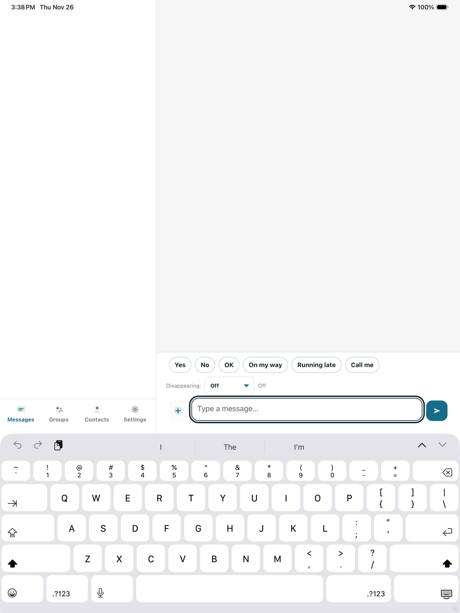
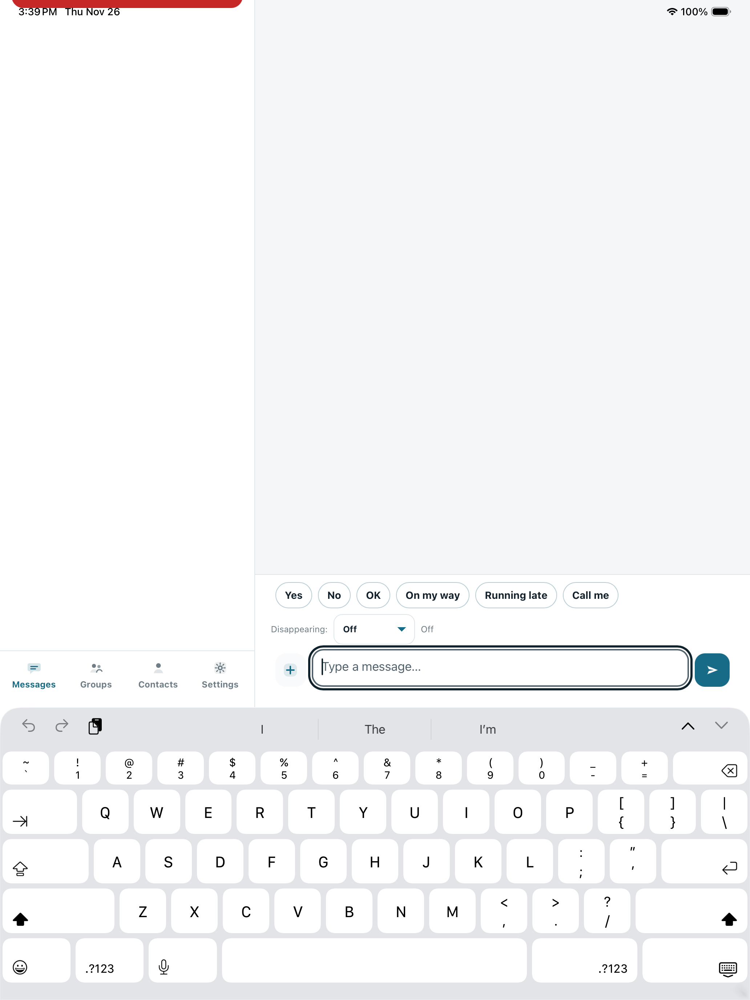
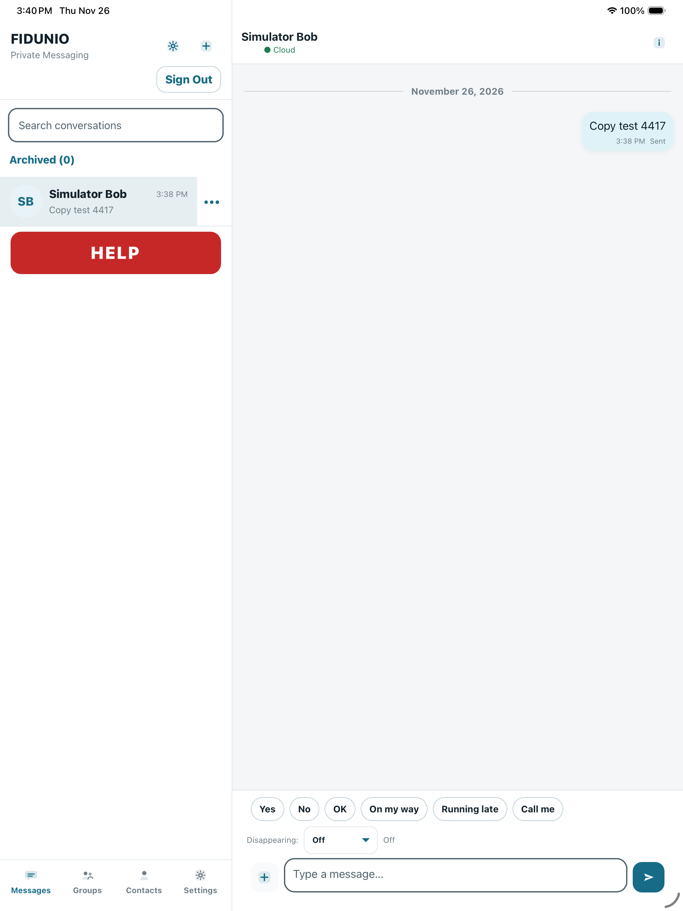
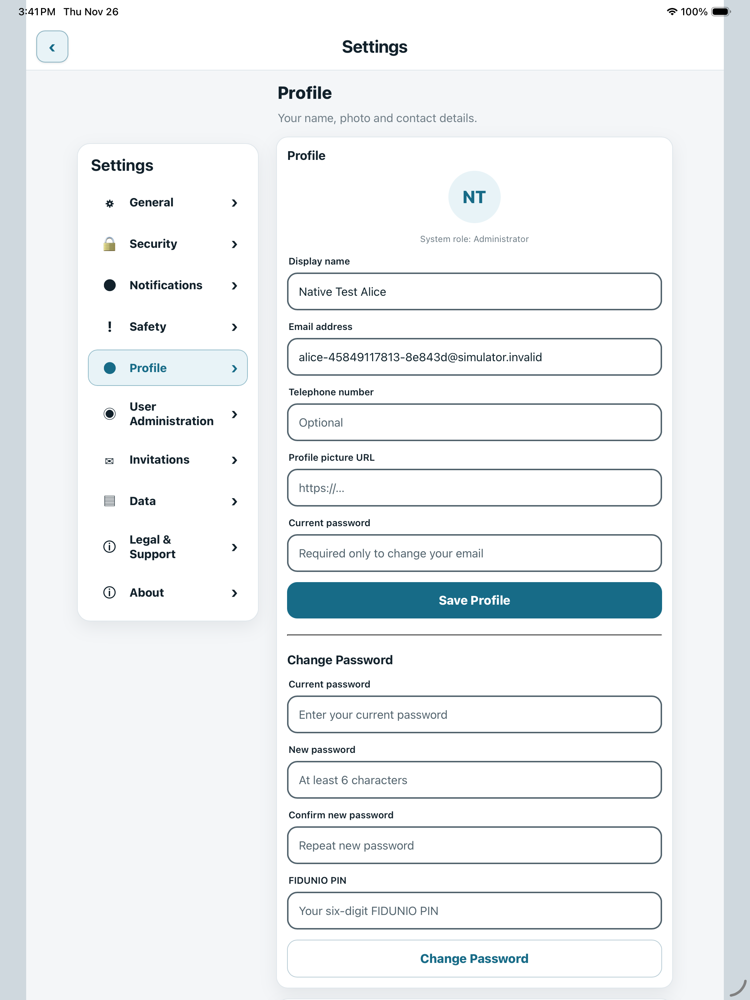

# FIDUNIO input probe — ios iPad — released

| Check | What | Expected | Observed | |
|---|---|---|---|---|
| IPAD-LAYOUT | iPad simulator, chat with Bob open | two-panel layout (list on the left, chat on the right) | two-panel with chat open | as expected |
| IPAD-BAR-LIVE | With the chat open, HELP contacts arrive from the server (Bob chosen on another device); touch nothing | the red HELP bar appears in the left panel within 20 s, without touching anything | HELP bar shown; still in chat: true; trace ["15:38:42 start","15:38:42 stop","15:38:43 settings snapshot exists=false cache=false pending=false contacts=-","15:38:43 settings applied (server read) contacts=0","15:38:58 settings snapshot exists=true cache=false pending=false contacts=1","15:38:58 settings applied (server read) contacts=1","15:38:58 bar redrawn shown"] | as expected |
| IPAD-BAR-RESTART-1 | Restart FIDUNIO, unlock with the PIN, touch nothing (round 1 of 3) | the red HELP bar is there within 20 s, without touching anything | unlocked: true; HELP bar shown; route: messages; trace ["15:39:31 start","15:39:31 stop","15:39:31 settings snapshot exists=true cache=false pending=false contacts=1","15:39:31 settings applied (server read) contacts=1","15:39:31 bar redrawn shown"] | as expected |
| IPAD-BAR-RESTART-2 | Restart FIDUNIO, unlock with the PIN, touch nothing (round 2 of 3) | the red HELP bar is there within 20 s, without touching anything | unlocked: true; HELP bar shown; route: messages; trace ["15:40:12 start","15:40:12 stop","15:40:12 settings snapshot exists=true cache=false pending=false contacts=1","15:40:12 settings applied (server read) contacts=1","15:40:12 bar redrawn shown"] | as expected |
| IPAD-BAR-RESTART-3 | Restart FIDUNIO, unlock with the PIN, touch nothing (round 3 of 3) | the red HELP bar is there within 20 s, without touching anything | unlocked: true; HELP bar shown; route: messages; trace ["15:40:50 start","15:40:50 stop","15:40:51 settings snapshot exists=true cache=false pending=false contacts=1","15:40:51 settings applied (server read) contacts=1","15:40:51 bar redrawn shown"] | as expected |
| IPAD-SETTINGS-FILL | Restart FIDUNIO, unlock, open Settings at once; touch nothing else | every part of Settings filled; the page is never rebuilt while loading | filled after 3 s; page rebuilt while open: 0 time(s); still filled 8 s later: true | as expected |

### IPAD-LAYOUT — 02-ipad-two-panel.png

### IPAD-BAR-LIVE — 03-ipad-bar-live.png

### IPAD-BAR-RESTART-1 — 04-ipad-bar-restart-1.png

### IPAD-BAR-RESTART-2 — 05-ipad-bar-restart-2.png

### IPAD-BAR-RESTART-3 — 06-ipad-bar-restart-3.png

### IPAD-SETTINGS-FILL — 07-ipad-settings-filled.png

