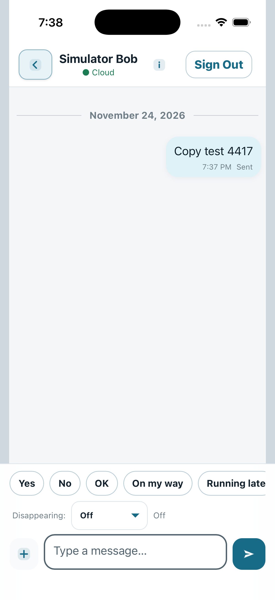
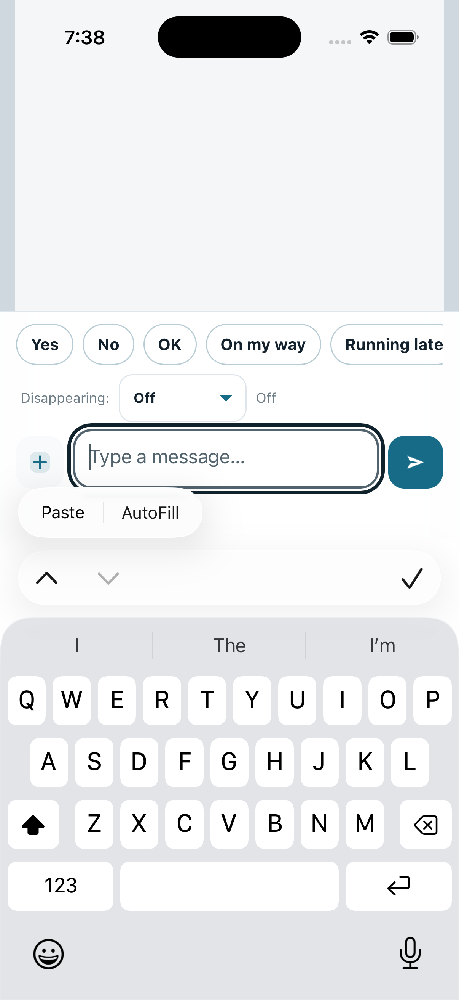
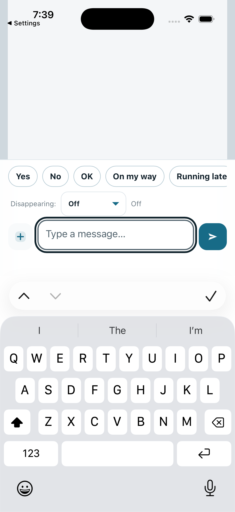

# FIDUNIO input probe — ios — released

| Check | What | Expected | Observed | |
|---|---|---|---|---|
| COPY | Press and hold a message, tap Copy | sheet offers Copy; the phone clipboard then holds the message text | action sheet closed; NO Copy button | **DIFFERENT** |
| PASTE | Press and hold the message box, tap the phone's Paste | the copied text appears in the message box | simulator clipboard set; NO Paste offered; message box now: "" | **DIFFERENT** |
| PICTURE-PASTE | A paste that carries a picture (what an iPhone sticker sends) | FIDUNIO sends it as a photo | nothing was sent | **DIFFERENT** |
| CAMERA | Photo → Take a Picture | the camera opens | screen shows: FIDUNIO / Toolbar / I / The / I’m / Q / W / E / R / T / Y / U / I / O / P / A / S / D / F / G / H / J / K / L / shift | **DIFFERENT** |
| GRACE | Switch to another app for ~15 s, then back | FIDUNIO opens unlocked (5 min grace) | unlocked | as expected |

### COPY — 02-copy-sheet.png

### PASTE — 04-after-paste.png

### PICTURE-PASTE — 05-picture-paste.png

### CAMERA — 06-after-take-picture.png

### GRACE — 07-back-after-15s.png

