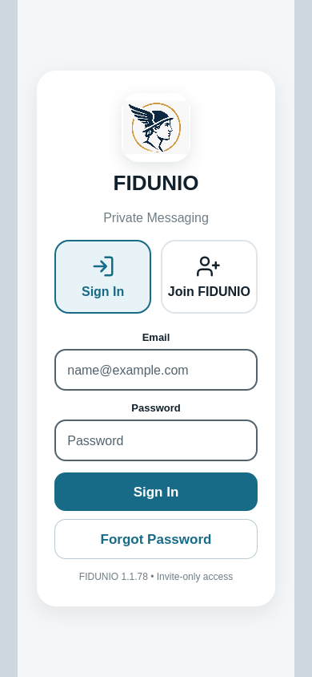
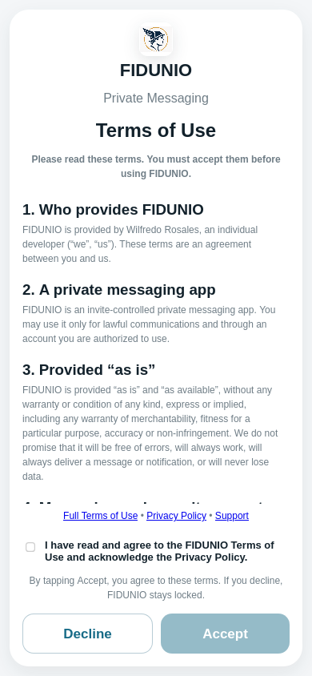

# FIDUNIO Android-shared - webkit simulated iPhone browser journey

**Result: FAIL**

- Source: Android-shared checkout; real shared source and browser engine
- Firebase config: demo project only; gstatic SDK and localhost Auth emulator
- GitHub run: https://github.com/willyros01/hermes/actions/runs/40113305588

## Verified assertions reported by the existing browser suite

- PASS: webkit fresh Terms, disabled Accept, decline lock, read again, visible controls and acceptance before auth

## Browser screen captures

### webkit-final-0-0.png

### webkit-terms.png

## Scope

This test exercises Terms, Join, startup, password visibility, invitation Universal Link simulation, PIN/biometrics mock failure, local cryptography storage, and safe startup recovery. It does not prove a real Face ID sensor or physical push receipt.
