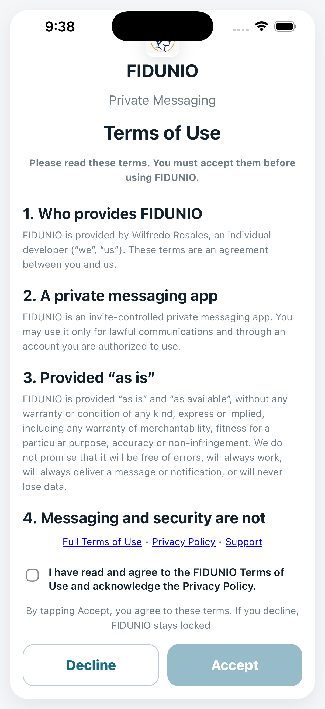
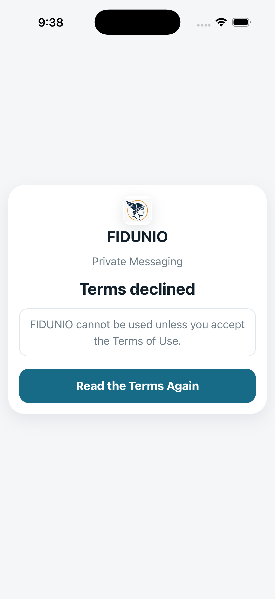
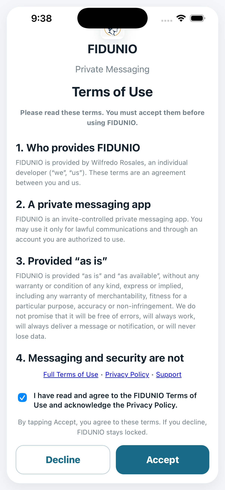
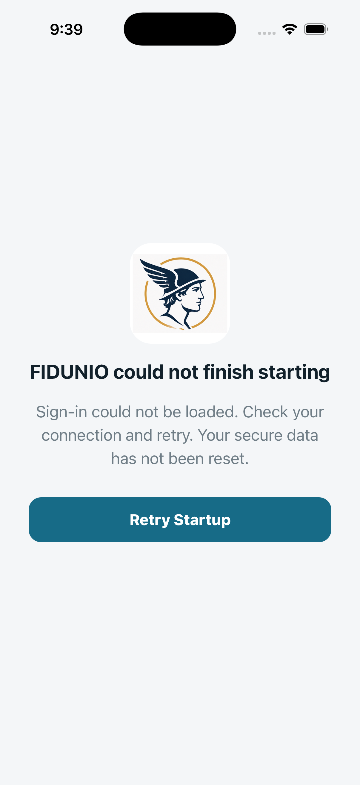

# FIDUNIO iPhone native simulator report

**Result: FAIL — 2 passed, 1 failed**

- GitHub run: https://github.com/willyros01/hermes/actions/runs/40134350042
- Simulator: iPhone disposable debug app
- Source branch: ios (read-only source checkout)
- Backend: Firebase project demo-fidunio-simulator-tests; local emulators only
- No authenticated user, production message, real push receipt, or actual camera capture was exercised

## Step-by-step checks

```text
FIDUNIO IOS native simulator, disposable data only

S1: Real native cold start shows legal Terms before Firebase login
    Capture: 01-terms-before-consent.png
PASS S1

S2: Declining Terms locks the app; Read Again resets consent
    Capture: 02-terms-declined-locked.png
    Capture: 03-terms-read-again.png
PASS S2

S3: Accept Terms and reach native Sign In without live backend
    Capture: 04-terms-ready-to-accept.png
    Capture: 05-S3-failure.png
FAIL S3: Error: Timeout: Sign In screen after Terms
    at waitFor (file:///Users/runner/work/hermes/hermes/build/simulator/device-run.mjs:55:9)
    at async file:///Users/runner/work/hermes/hermes/build/simulator/device-run.mjs:127:5
    at async step (file:///Users/runner/work/hermes/hermes/build/simulator/device-run.mjs:69:7)
    at async file:///Users/runner/work/hermes/hermes/build/simulator/device-run.mjs:122:3

Stopped: Timeout: Sign In screen after Terms

FINAL 2 passed, 1 failed
```

## Actual device screen captures

### terms-before-consent



### terms-declined-locked



### terms-read-again


### terms-ready-to-accept



### S3-failure



## Coverage limitations

- This is a real native shell and WebView journey, but pre-auth only. Authenticated encrypted message flows are covered by separately labeled source/emulator tests.
- Native APNs/ADM/FCM delivery and push-tap routing cannot be proved on these disposable emulators.
- Biometric sensor success and camera picker handling require physical devices.
- The separate browser suite tests simulated biometric failure and PIN fallback.
