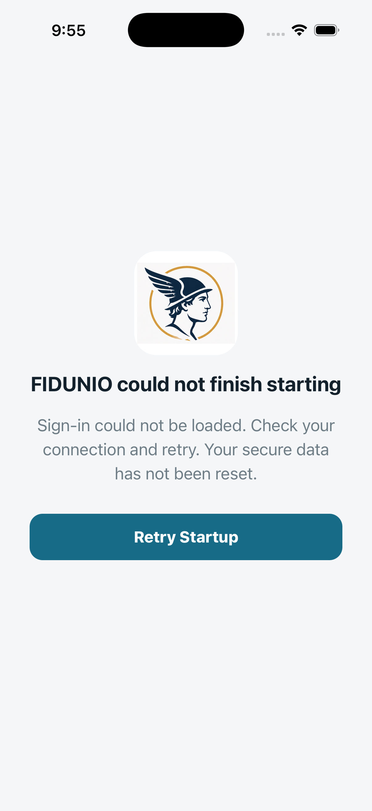

# FIDUNIO authenticated iPhone native simulator results

**FAIL — 0 passed, 1 failed, 13 blocked**

- Installed app: disposable native debug binary built from ios release source
- Local Firebase: Auth, Firestore with original rules, Storage — demo-fidunio-simulator-tests ONLY
- Backend exception: enrollRecoveryV1 uses a localhost implementation of the repository recovery wrapper; production Cloud Functions are NOT validated.
- Native UI operations are genuine app control gestures via OS WebView inspector; database assertions read the emulator, not production.
- No ADM, APNs, FCM provider delivery, physical biometrics, real camera, or peer-device decryption is claimed.

## Functional results

### N01 — FAIL: Accept legal Terms and open actual Join form

Error: Timed out waiting for Join tab; ; screen:  FIDUNIO could not finish starting Sign-in could not be loaded. Check your connection and retry. Your secure data has not been reset. Retry Startup
    at wait (file:///Users/runner/work/hermes/hermes/build/simulator/device-auth-run.mjs:26:200)
    at process.processTicksAndRejections (node:internal/process/task_queues:103:5)
    at async file:///Users/runner/work/hermes/hermes/build/simulator/device-auth-run.mjs:62:5
    at async test (file:///Users/runner/work/hermes/hermes/build/simulator/device-auth-run.mjs:33:20)
    at async file:///Users/runner/work/hermes/hermes/build/simulator/device-auth-run.mjs:59:12

### N02 — BLOCKED: Consume a real single-use admin invite, set PIN, create E2EE identity through native Join

Earlier prerequisite failed

### N03 — BLOCKED: Change actual native Settings: A++, Dark, and preview option

Earlier prerequisite failed

### N04 — BLOCKED: Admin creates a new user invitation from native Settings

Earlier prerequisite failed

### N05 — BLOCKED: Start a native direct conversation with Bob

Earlier prerequisite failed

### N06 — BLOCKED: Send encrypted direct text and confirm NO plaintext in emulator

Earlier prerequisite failed

### N07 — BLOCKED: Set disappearing timer in real native direct conversation

Earlier prerequisite failed

### N08 — BLOCKED: React with an emoji to an accepted direct message

Earlier prerequisite failed

### N09 — BLOCKED: Create group from native app and verify admin controls

Earlier prerequisite failed

### N10 — BLOCKED: Send a native group message and verify encrypted group record

Earlier prerequisite failed

### N11 — BLOCKED: Use native group administrator to add a member

Earlier prerequisite failed

### N12 — BLOCKED: Show native notification configuration controls (delivery requires real devices)

Earlier prerequisite failed

### N13 — BLOCKED: Block and unblock a native user in Safety settings

Earlier prerequisite failed

### N14 — BLOCKED: A++ and Dark settings survive leaving and reopening native Settings

Earlier prerequisite failed

## Captured native screens

### N01-failure



## Execution record

```text
Native authenticated ios suite. LOCAL demo-only accounts.

N01: Accept legal Terms and open actual Join form
FAIL N01: Error: Timed out waiting for Join tab; ; screen:  FIDUNIO could not finish starting Sign-in could not be loaded. Check your connection and retry. Your secure data has not been reset. Retry Startup
    at wait (file:///Users/runner/work/hermes/hermes/build/simulator/device-auth-run.mjs:26:200)
    at process.processTicksAndRejections (node:internal/process/task_queues:103:5)
    at async file:///Users/runner/work/hermes/hermes/build/simulator/device-auth-run.mjs:62:5
    at async test (file:///Users/runner/work/hermes/hermes/build/simulator/device-auth-run.mjs:33:20)
    at async file:///Users/runner/work/hermes/hermes/build/simulator/device-auth-run.mjs:59:12
  Actual native screenshot: 01-N01-failure.png

N02: Consume a real single-use admin invite, set PIN, create E2EE identity through native Join
BLOCKED N02

N03: Change actual native Settings: A++, Dark, and preview option
BLOCKED N03

N04: Admin creates a new user invitation from native Settings
BLOCKED N04

N05: Start a native direct conversation with Bob
BLOCKED N05

N06: Send encrypted direct text and confirm NO plaintext in emulator
BLOCKED N06

N07: Set disappearing timer in real native direct conversation
BLOCKED N07

N08: React with an emoji to an accepted direct message
BLOCKED N08

N09: Create group from native app and verify admin controls
BLOCKED N09

N10: Send a native group message and verify encrypted group record
BLOCKED N10

N11: Use native group administrator to add a member
BLOCKED N11

N12: Show native notification configuration controls (delivery requires real devices)
BLOCKED N12

N13: Block and unblock a native user in Safety settings
BLOCKED N13

N14: A++ and Dark settings survive leaving and reopening native Settings
BLOCKED N14
Native authenticated suite found failures or blocked checks — no production code modified.

```
