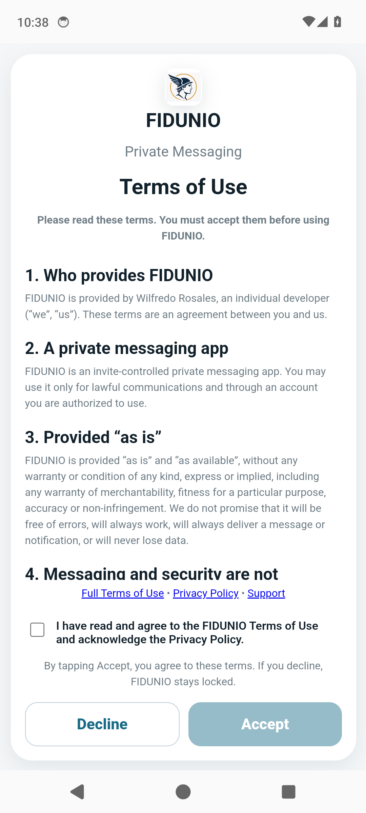
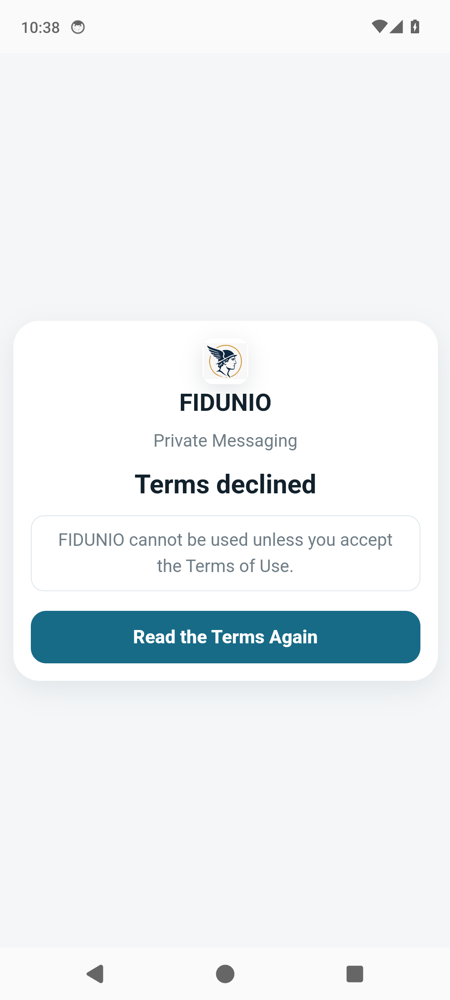
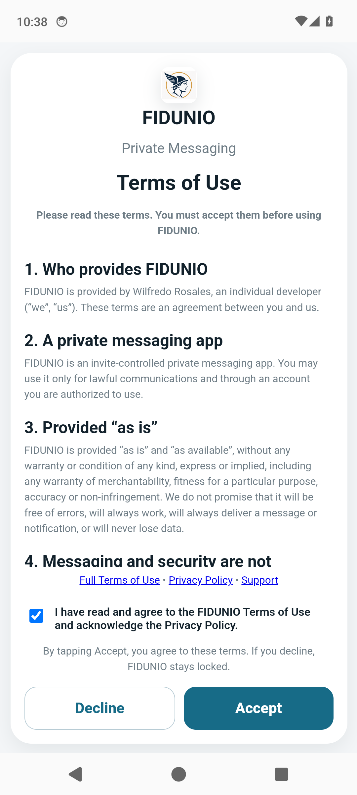
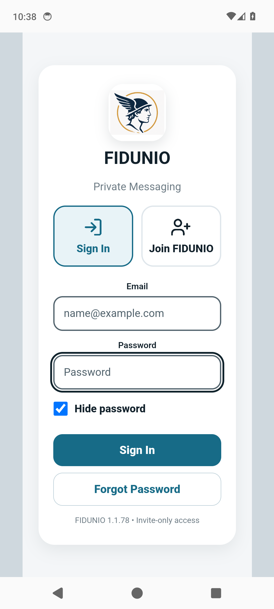
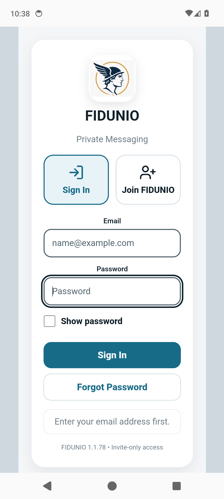
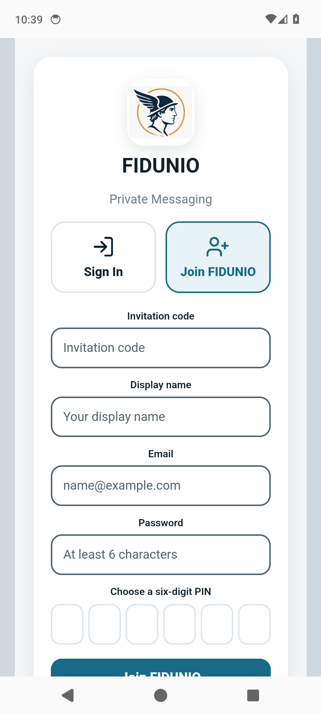
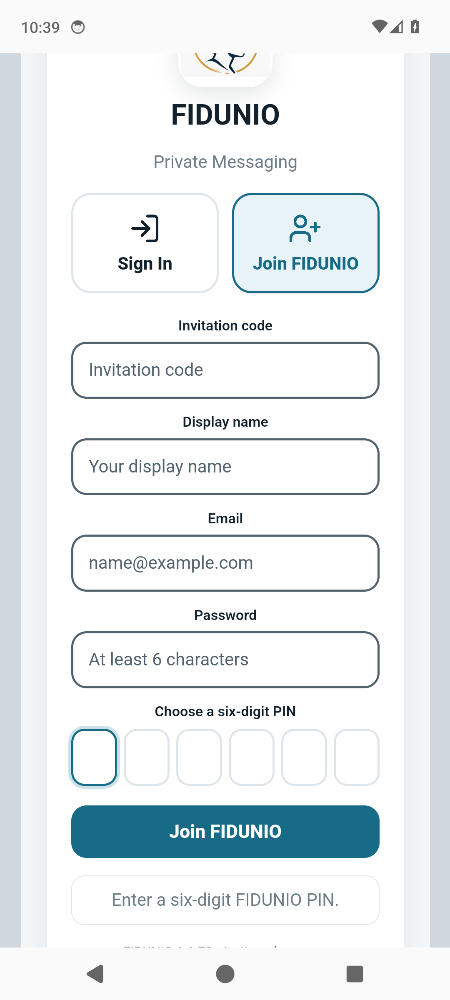
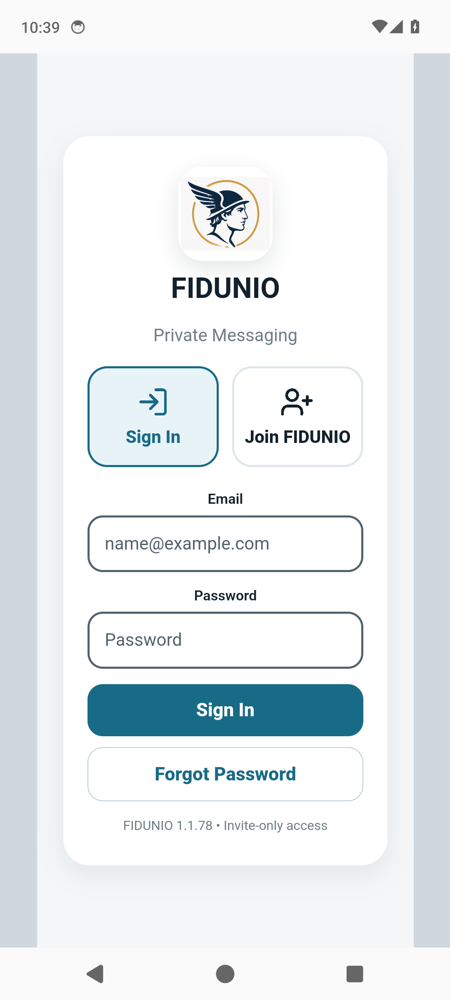

# FIDUNIO Android native simulator report

**Result: PASS — 7 passed, 0 failed**

- GitHub run: https://github.com/willyros01/hermes/actions/runs/40139029131
- Simulator: Android API 34 AOSP disposable debug app
- Source branch: Android (read-only source checkout)
- Backend: Firebase project demo-fidunio-simulator-tests; local emulators only
- No authenticated user, production message, real push receipt, or actual camera capture was exercised

## Step-by-step checks

```text
FIDUNIO ANDROID native simulator, disposable data only

S1: Real native cold start shows legal Terms before Firebase login
    Capture: 01-terms-before-consent.png
PASS S1

S2: Declining Terms locks the app; Read Again resets consent
    Capture: 02-terms-declined-locked.png
    Capture: 03-terms-read-again.png
PASS S2

S3: Accept Terms and reach native Sign In without live backend
    Capture: 04-terms-ready-to-accept.png
    Capture: 05-sign-in.png
PASS S3

S4: Password visibility toggles without submitting credentials
    Capture: 06-password-visible.png
PASS S4

S5: Forgot Password rejects blank email without network write
    Capture: 07-forgot-password-validation.png
PASS S5

S6: Join flow requires six-digit PIN; no account is created
    Capture: 08-join-page.png
    Capture: 09-join-pin-required.png
PASS S6

S7: App restart preserves Terms and does not expose a chat
    Capture: 10-sign-in-after-restart.png
PASS S7

FINAL 7 passed, 0 failed
```

## Actual device screen captures

### terms-before-consent



### terms-declined-locked



### terms-read-again


### terms-ready-to-accept



### sign-in


### password-visible



### forgot-password-validation



### join-page



### join-pin-required



### sign-in-after-restart



## Coverage limitations

- This is a real native shell and WebView journey, but pre-auth only. Authenticated encrypted message flows are covered by separately labeled source/emulator tests.
- Native APNs/ADM/FCM delivery and push-tap routing cannot be proved on these disposable emulators.
- Biometric sensor success and camera picker handling require physical devices.
- The separate browser suite tests simulated biometric failure and PIN fallback.
