# FIDUNIO authenticated iPhone native simulator results

**FAIL — 12 passed, 1 failed, 1 blocked**

- Installed app: disposable native debug binary built from ios release source
- Local Firebase: Auth, Firestore with original rules, Storage — demo-fidunio-simulator-tests ONLY
- Backend exception: enrollRecoveryV1 uses a localhost implementation of the repository recovery wrapper; production Cloud Functions are NOT validated.
- Native UI operations are genuine app control gestures via OS WebView inspector; database assertions read the emulator, not production.
- No ADM, APNs, FCM provider delivery, physical biometrics, real camera, or peer-device decryption is claimed.

## Functional results

### N01 — PASS: Accept legal Terms and open actual Join form

Observed on native device

### N02 — PASS: Consume a real single-use admin invite, set PIN, create E2EE identity through native Join

Admin invitation accepted; real Auth profile and account E2EE identity created in local Firebase (iPhone volatile key-cache workaround used)

### N03 — PASS: Change actual native Settings: A++, Dark, and preview option

On-device Settings widgets changed and rendered selected values

### N04 — PASS: Admin creates a new user invitation from native Settings

Admin UI created an authentic single-use invitation in local Firestore

### N05 — PASS: Start a native direct conversation with Bob

Observed on native device

### N06 — PASS: Send encrypted direct text and confirm NO plaintext in emulator

Native composer sent an encrypted message with no plaintext in Firestore

### N07 — PASS: Set disappearing timer in real native direct conversation

Actual per-conversation disappearing selector changed to 300 seconds

### N08 — PASS: React with an emoji to an accepted direct message

Native message action displayed and applied emoji reaction

### N09 — PASS: Create group from native app and verify admin controls

Real group creation and group-admin rename/add/remove controls visible in native app

### N10 — PASS: Send a native group message and verify encrypted group record

Actual native group composer wrote encrypted content to local Firestore

### N11 — PASS: Use native group administrator to add a member

Native Group Info added Owner account as a new member; Firestore membership confirmed

### N12 — PASS: Show native notification configuration controls (delivery requires real devices)

Notification UI exists and renders. Actual ADM/APNs push reception NOT tested

### N13 — FAIL: Block and unblock a native user in Safety settings

Error: could not reach the app's web view (Web Inspector)
    at connect (file:///Users/runner/work/hermes/hermes/build/simulator/sim.mjs:26:20)
    at async js1 (file:///Users/runner/work/hermes/hermes/build/simulator/sim.mjs:39:3)
    at async Module.press (file:///Users/runner/work/hermes/hermes/build/simulator/sim.mjs:66:14)
    at async test.requires (file:///Users/runner/work/hermes/hermes/build/simulator/device-auth-run.mjs:246:7)
    at async test (file:///Users/runner/work/hermes/hermes/build/simulator/device-auth-run.mjs:33:20)
    at async file:///Users/runner/work/hermes/hermes/build/simulator/device-auth-run.mjs:232:13

### N14 — BLOCKED: A++ and Dark settings survive leaving and reopening native Settings

Earlier prerequisite failed

## Captured native screens

### native-join-screen

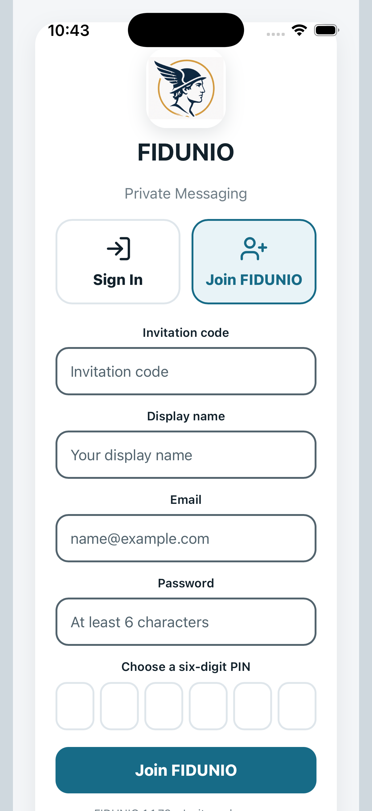

### native-join-completed

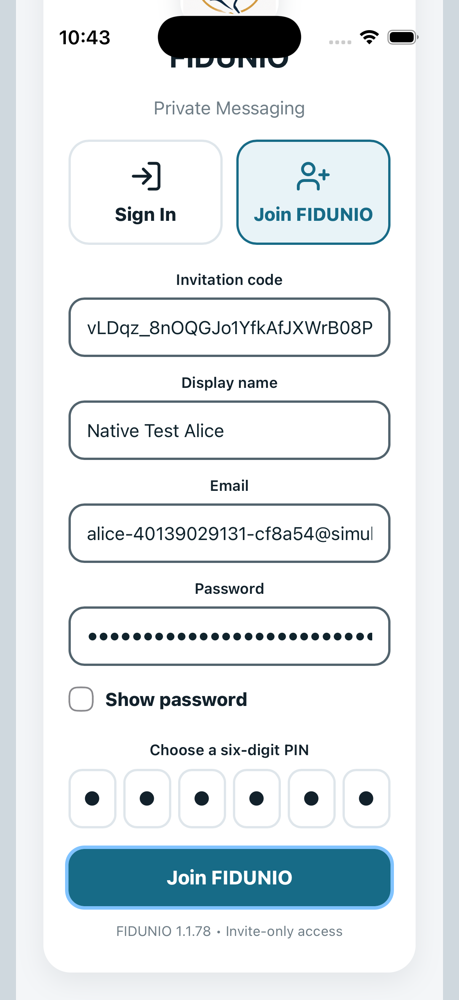

### native-authenticated-messages

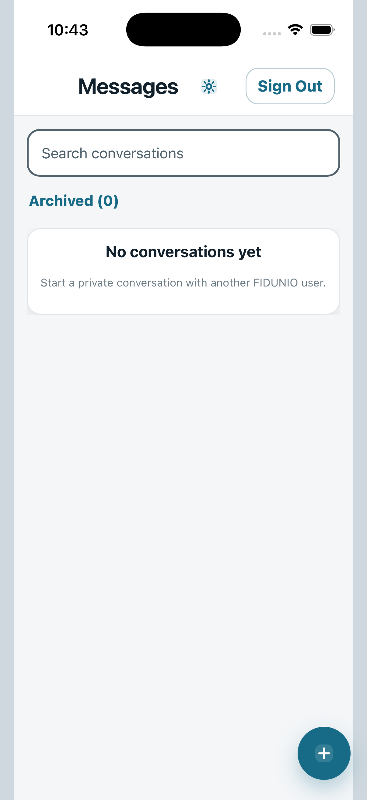

### native-settings-large-dark

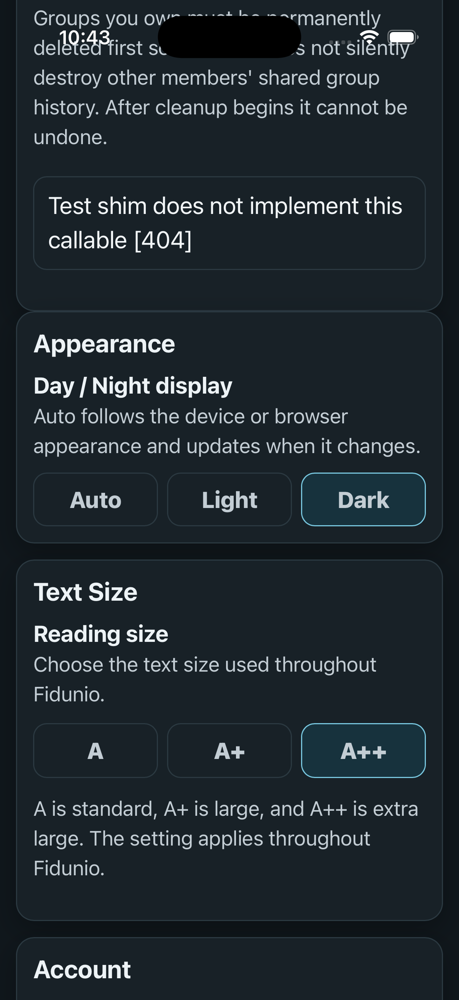

### native-admin-invitation

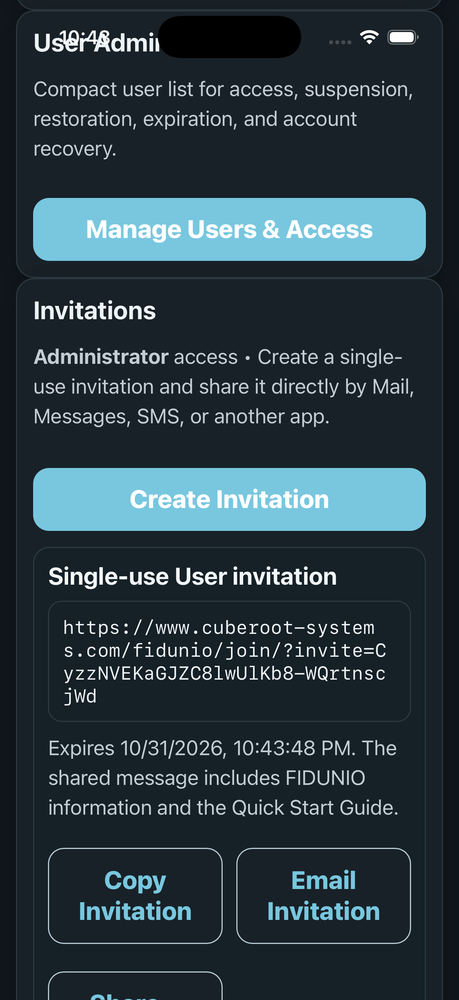

### native-direct-chat

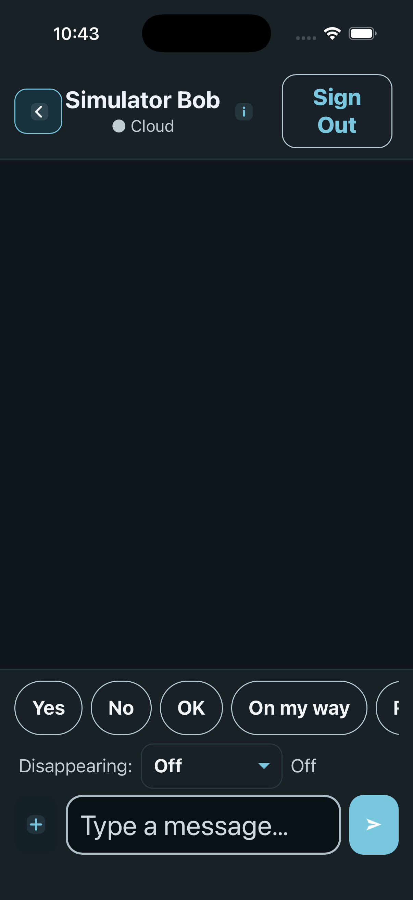

### native-direct-message-sent

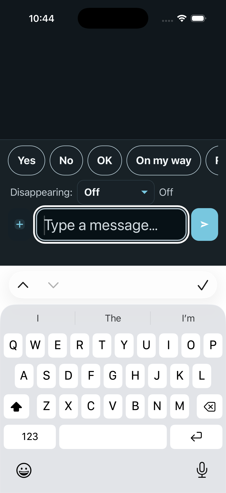

### native-disappearing-setting

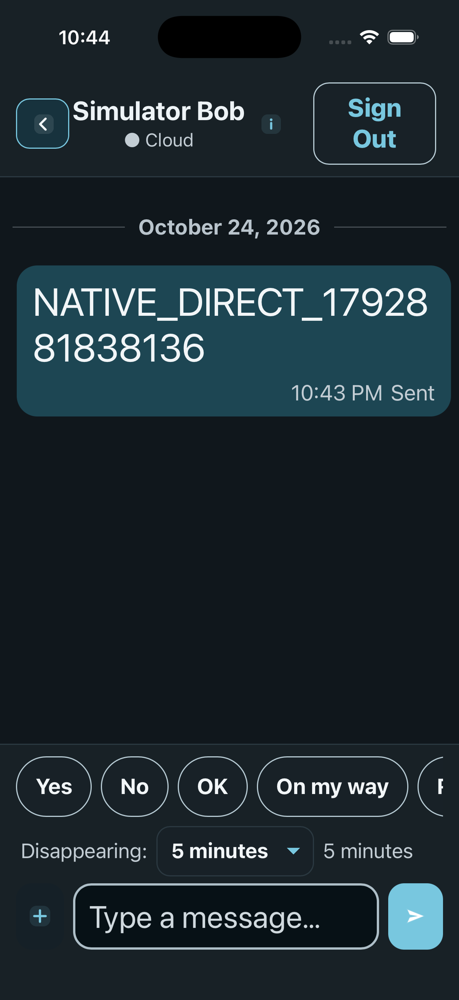

### native-emoji-reaction

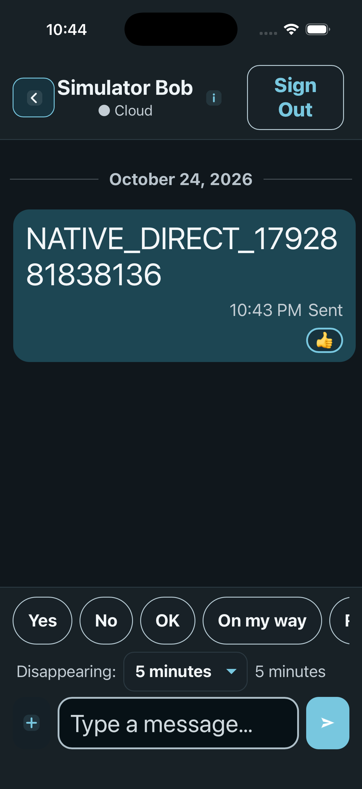

### native-group-created

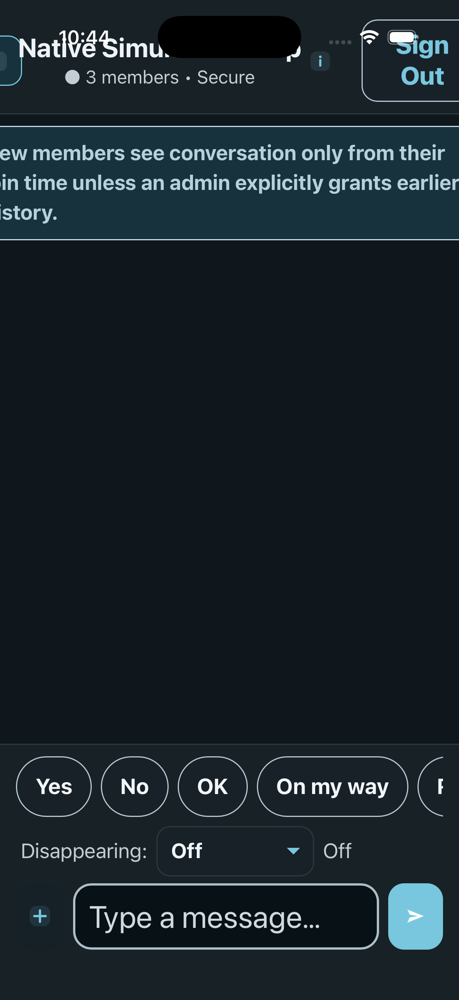

### native-group-admin

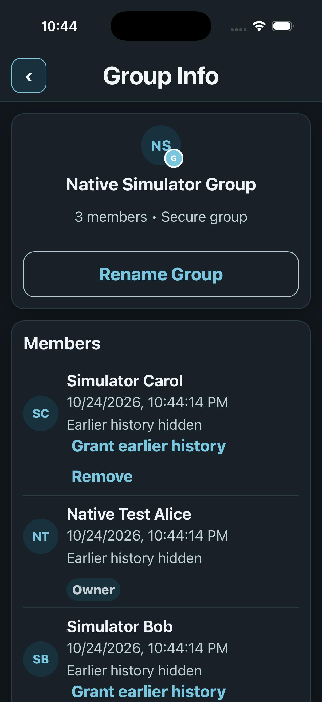

### native-group-message-sent

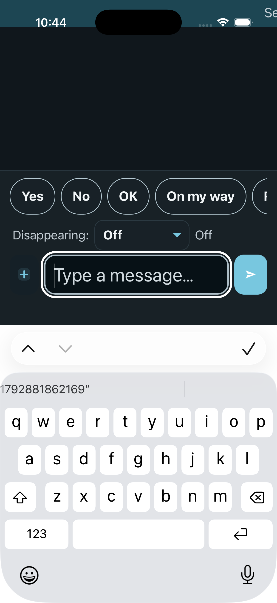

### native-group-member-added

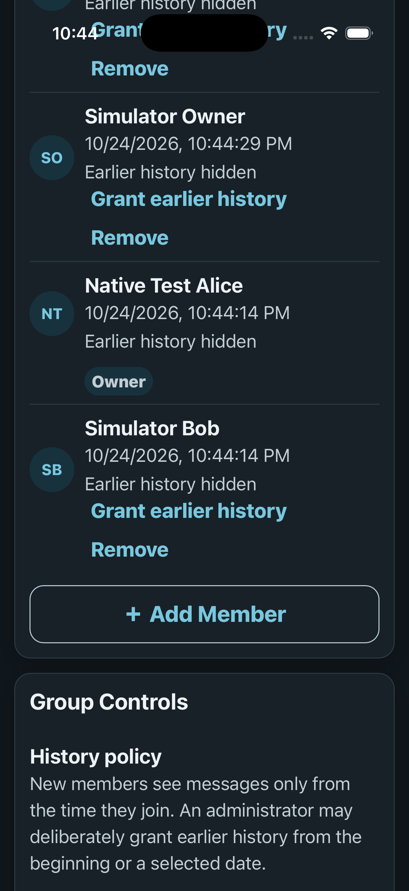

### native-notification-settings

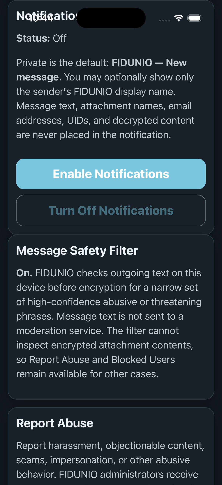

### N13-failure

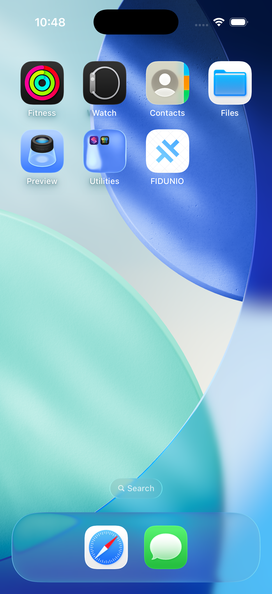

## Execution record

```text
Native authenticated ios suite. LOCAL demo-only accounts.

N01: Accept legal Terms and open actual Join form
  Actual native screenshot: 01-native-join-screen.png
PASS N01
  Local Firestore HTTP probe: {"state":"reachable"}

N02: Consume a real single-use admin invite, set PIN, create E2EE identity through native Join
  Actual native screenshot: 02-native-join-completed.png
  Actual native screenshot: 03-native-authenticated-messages.png
  SIMULATOR-ONLY iPhone volatile CryptoKey fallback was used; IndexedDB key persistence/restart NOT VERIFIED
PASS N02

N03: Change actual native Settings: A++, Dark, and preview option
  Actual native screenshot: 04-native-settings-large-dark.png
PASS N03

N04: Admin creates a new user invitation from native Settings
  Actual native screenshot: 05-native-admin-invitation.png
PASS N04

N05: Start a native direct conversation with Bob
  Actual native screenshot: 06-native-direct-chat.png
PASS N05

N06: Send encrypted direct text and confirm NO plaintext in emulator
  Actual native screenshot: 07-native-direct-message-sent.png
PASS N06

N07: Set disappearing timer in real native direct conversation
  Actual native screenshot: 08-native-disappearing-setting.png
PASS N07

N08: React with an emoji to an accepted direct message
  Actual native screenshot: 09-native-emoji-reaction.png
PASS N08

N09: Create group from native app and verify admin controls
  Actual native screenshot: 10-native-group-created.png
  Actual native screenshot: 11-native-group-admin.png
PASS N09

N10: Send a native group message and verify encrypted group record
  Actual native screenshot: 12-native-group-message-sent.png
PASS N10

N11: Use native group administrator to add a member
  Actual native screenshot: 13-native-group-member-added.png
PASS N11

N12: Show native notification configuration controls (delivery requires real devices)
  Actual native screenshot: 14-native-notification-settings.png
PASS N12

N13: Block and unblock a native user in Safety settings
FAIL N13: Error: could not reach the app's web view (Web Inspector)
    at connect (file:///Users/runner/work/hermes/hermes/build/simulator/sim.mjs:26:20)
    at async js1 (file:///Users/runner/work/hermes/hermes/build/simulator/sim.mjs:39:3)
    at async Module.press (file:///Users/runner/work/hermes/hermes/build/simulator/sim.mjs:66:14)
    at async test.requires (file:///Users/runner/work/hermes/hermes/build/simulator/device-auth-run.mjs:246:7)
    at async test (file:///Users/runner/work/hermes/hermes/build/simulator/device-auth-run.mjs:33:20)
    at async file:///Users/runner/work/hermes/hermes/build/simulator/device-auth-run.mjs:232:13
  Actual native screenshot: 15-N13-failure.png

N14: A++ and Dark settings survive leaving and reopening native Settings
BLOCKED N14
Native authenticated suite found failures or blocked checks — no production code modified.

```
