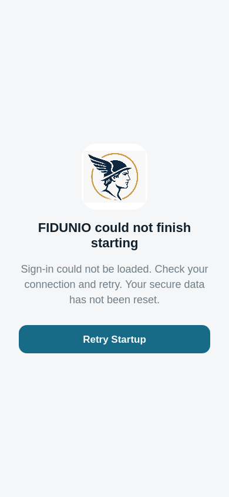
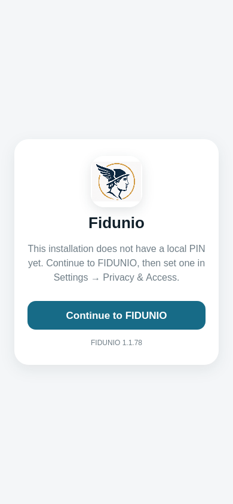
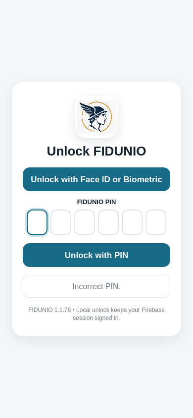

# FIDUNIO ios-shared - webkit simulated iPhone browser journey

**Result: PASS**

- Source: ios-shared checkout; real shared source and browser engine
- Firebase config: demo project only; gstatic SDK and localhost Auth emulator
- GitHub run: https://github.com/willyros01/hermes/actions/runs/40140298968

## Verified assertions reported by the existing browser suite

- PASS: webkit fresh Terms, disabled Accept, decline lock, read again, visible controls and acceptance before auth
- PASS: webkit native Firebase Auth local persistence survives reload against isolated Auth emulator
- PASS: webkit native cold startup/reload, auth tabs, password visibility, validation and no web service worker
- PASS: webkit cold Universal Link reaches shared Join screen with invitation token
- PASS: webkit warm Universal Link reaches shared Join screen with invitation token
- PASS: webkit Face ID-first unlock hides PIN and keeps blank/wrong PIN failures interactive
- PASS: webkit simulated Face ID failure exposes a usable PIN fallback
- PASS: webkit rejected SDK load reports failure and retry recovers without bypass
- PASS: webkit stalled startup is visible and cannot bypass authentication

## Browser screen captures

### webkit-load-failure.png

### webkit-sign-in.png

### webkit-terms.png

### webkit-unlock-pin-fallback.png

## Scope

This test exercises Terms, Join, startup, password visibility, invitation Universal Link simulation, PIN/biometrics mock failure, local cryptography storage, and safe startup recovery. It does not prove a real Face ID sensor or physical push receipt.
