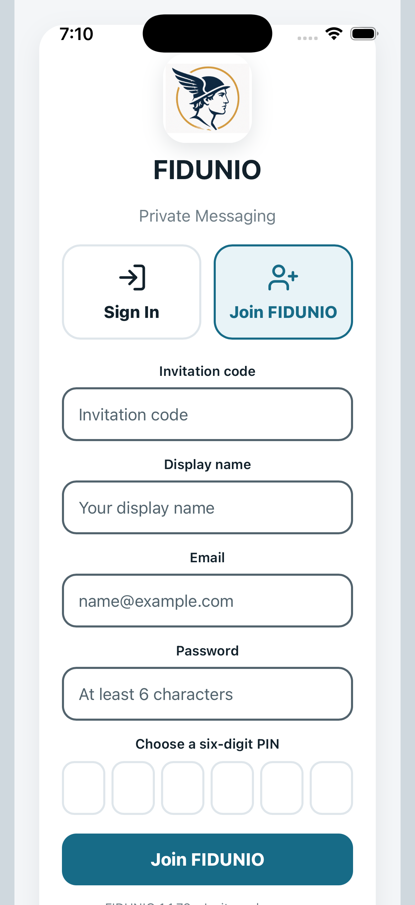
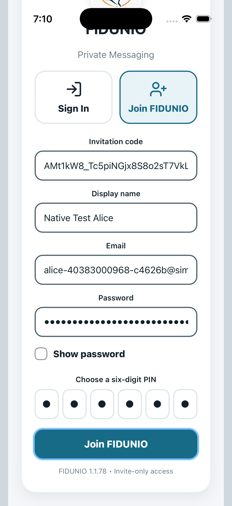
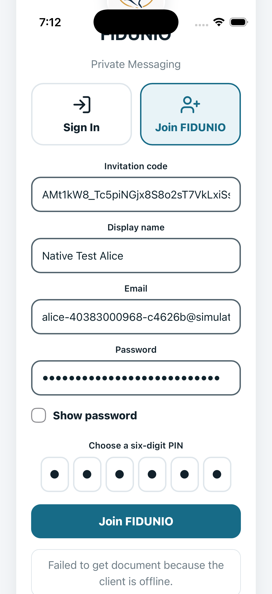

# FIDUNIO authenticated iPhone native simulator results

**FAIL — 1 passed, 1 failed, 21 blocked**

- Installed app: disposable native debug binary built from ios release source
- Local Firebase: Auth, Firestore with original rules, Storage — demo-fidunio-simulator-tests ONLY
- Backend exception: enrollRecoveryV1 uses a localhost implementation of the repository recovery wrapper; production Cloud Functions are NOT validated.
- Native UI operations are genuine app control gestures via OS WebView inspector; database assertions read the emulator, not production.
- No ADM, APNs, FCM provider delivery, physical biometrics, real camera, or peer-device decryption is claimed.

## Functional results

### N01 — PASS: Accept legal Terms and open actual Join form

Observed on native device

### N02 — FAIL: Consume a real single-use admin invite, set PIN, create E2EE identity through native Join

Error: Timed out waiting for authenticated Messages screen; ; screen:  FIDUNIO Private Messaging Sign In Join FIDUNIO Invitation code Display name Email Password Show password Choose a six-digit PIN Join FIDUNIO Failed to get document because the client is offline. FIDUNIO 1.1.78 • Invite-only access
    at wait (file:///Users/runner/work/hermes/hermes/build/simulator/device-auth-run.mjs:26:200)
    at process.processTicksAndRejections (node:internal/process/task_queues:103:5)
    at async test.requires (file:///Users/runner/work/hermes/hermes/build/simulator/device-auth-run.mjs:115:5)
    at async test (file:///Users/runner/work/hermes/hermes/build/simulator/device-auth-run.mjs:34:20)
    at async file:///Users/runner/work/hermes/hermes/build/simulator/device-auth-run.mjs:101:12
SIMULATOR DIAGNOSTIC PHASE: unavailable

### N03 — BLOCKED: Change actual native Settings: A++, Dark, and preview option

Earlier prerequisite failed

### N04 — BLOCKED: Admin creates a new user invitation from native Settings

Earlier prerequisite failed

### N05 — BLOCKED: Start a native direct conversation with Bob

Earlier prerequisite failed

### N06 — BLOCKED: Send encrypted direct text and confirm NO plaintext in emulator

Earlier prerequisite failed

### N07 — BLOCKED: Set disappearing timer in real native direct conversation

Earlier prerequisite failed

### N08 — BLOCKED: React with an emoji to an accepted direct message

Earlier prerequisite failed

### N09 — BLOCKED: Create group from native app and verify admin controls

Earlier prerequisite failed

### N10 — BLOCKED: Send a native group message and verify encrypted group record

Earlier prerequisite failed

### N11 — BLOCKED: Use native group administrator to add a member

Earlier prerequisite failed

### N12 — BLOCKED: Show native notification configuration controls (delivery requires real devices)

Earlier prerequisite failed

### N13 — BLOCKED: Block and unblock a native user in Safety settings

Earlier prerequisite failed

### N14 — BLOCKED: A++ and Dark settings survive leaving and reopening native Settings

Earlier prerequisite failed

### R01 — BLOCKED: Full six-emoji native picker: apply, change, remove each choice

Earlier prerequisite failed

### R02 — BLOCKED: Group Delete for Me hides local message but keeps shared ciphertext

Earlier prerequisite failed

### R03 — BLOCKED: Native group message Reply composer sends ciphertext-only response

Earlier prerequisite failed

### R04 — BLOCKED: Direct emoji picker applies and removes all six emotions

Earlier prerequisite failed

### R05 — BLOCKED: Direct Delete for Me hides only sender local copy

Earlier prerequisite failed

### R06 — BLOCKED: Archive and unarchive direct conversation using native Messages controls

Earlier prerequisite failed

### R09 — BLOCKED: Group send continuity while encrypted Outbox is held through navigation

Earlier prerequisite failed

### R07 — BLOCKED: Group reaction stress — four complete six-emoji cycles across native chat reopen

Earlier prerequisite failed

### R08 — BLOCKED: Direct reaction stress — four complete six-emoji cycles across native chat reopen

Earlier prerequisite failed

## Captured native screens

### native-join-screen



### native-join-completed



### N02-failure



## Execution record

```text
Native authenticated ios suite. LOCAL demo-only accounts.

N01: Accept legal Terms and open actual Join form
  Actual native screenshot: 01-native-join-screen.png
PASS N01
  Local Firestore HTTP probe: {"state":"reachable"}

N02: Consume a real single-use admin invite, set PIN, create E2EE identity through native Join
  Actual native screenshot: 02-native-join-completed.png
FAIL N02: Error: Timed out waiting for authenticated Messages screen; ; screen:  FIDUNIO Private Messaging Sign In Join FIDUNIO Invitation code Display name Email Password Show password Choose a six-digit PIN Join FIDUNIO Failed to get document because the client is offline. FIDUNIO 1.1.78 • Invite-only access
    at wait (file:///Users/runner/work/hermes/hermes/build/simulator/device-auth-run.mjs:26:200)
    at process.processTicksAndRejections (node:internal/process/task_queues:103:5)
    at async test.requires (file:///Users/runner/work/hermes/hermes/build/simulator/device-auth-run.mjs:115:5)
    at async test (file:///Users/runner/work/hermes/hermes/build/simulator/device-auth-run.mjs:34:20)
    at async file:///Users/runner/work/hermes/hermes/build/simulator/device-auth-run.mjs:101:12
SIMULATOR DIAGNOSTIC PHASE: unavailable
  Actual native screenshot: 03-N02-failure.png

N03: Change actual native Settings: A++, Dark, and preview option
BLOCKED N03

N04: Admin creates a new user invitation from native Settings
BLOCKED N04

N05: Start a native direct conversation with Bob
BLOCKED N05

N06: Send encrypted direct text and confirm NO plaintext in emulator
BLOCKED N06

N07: Set disappearing timer in real native direct conversation
BLOCKED N07

N08: React with an emoji to an accepted direct message
BLOCKED N08

N09: Create group from native app and verify admin controls
BLOCKED N09

N10: Send a native group message and verify encrypted group record
BLOCKED N10

N11: Use native group administrator to add a member
BLOCKED N11

N12: Show native notification configuration controls (delivery requires real devices)
BLOCKED N12

N13: Block and unblock a native user in Safety settings
BLOCKED N13

N14: A++ and Dark settings survive leaving and reopening native Settings
BLOCKED N14

R01: Full six-emoji native picker: apply, change, remove each choice
BLOCKED R01

R02: Group Delete for Me hides local message but keeps shared ciphertext
BLOCKED R02

R03: Native group message Reply composer sends ciphertext-only response
BLOCKED R03

R04: Direct emoji picker applies and removes all six emotions
BLOCKED R04

R05: Direct Delete for Me hides only sender local copy
BLOCKED R05

R06: Archive and unarchive direct conversation using native Messages controls
BLOCKED R06
Release extension native scenarios complete: 0/3 primary passed; direct extension FAIL/BLOCKED

R09: Group send continuity while encrypted Outbox is held through navigation
BLOCKED R09

R07: Group reaction stress — four complete six-emoji cycles across native chat reopen
BLOCKED R07

R08: Direct reaction stress — four complete six-emoji cycles across native chat reopen
BLOCKED R08
REACTION-STRESS summary interruptedGroupSend=false group=false direct=false; no release approval implied.
Native simulator suite contains failures or blocked tests; NO release approval.

```
